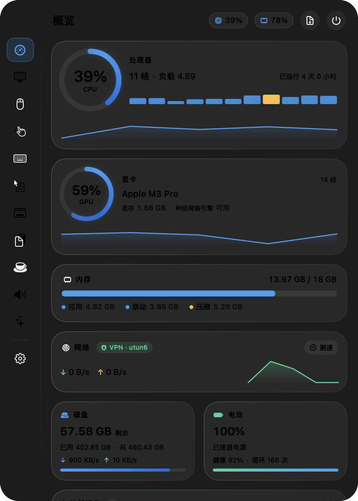
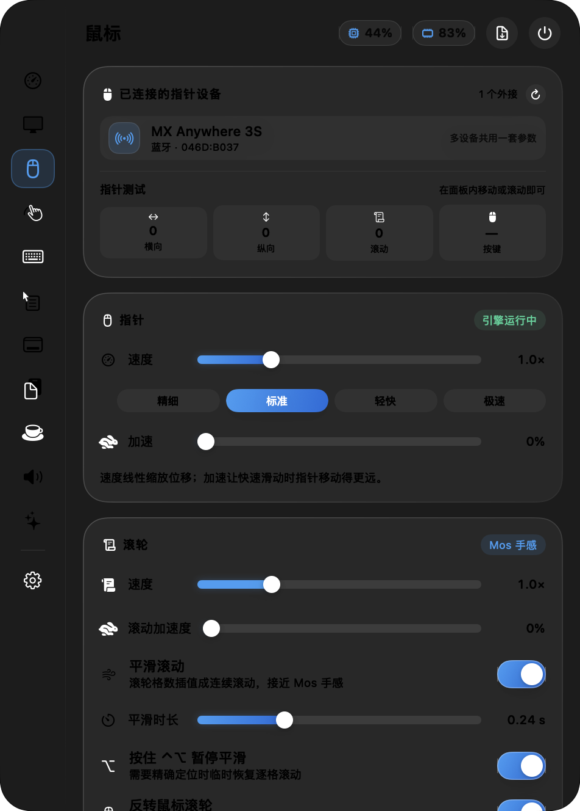
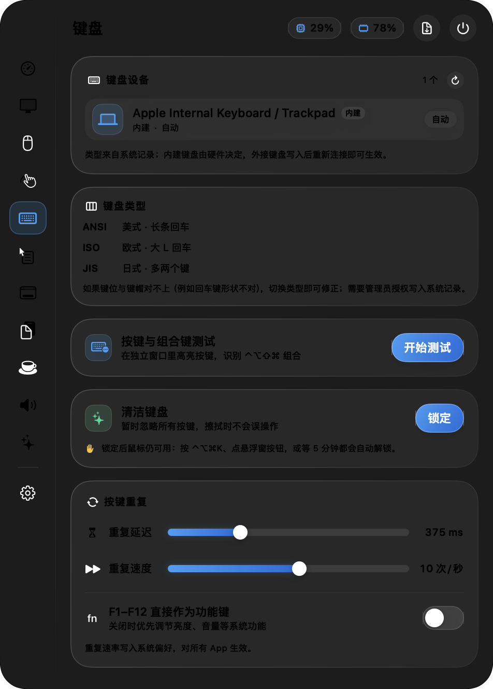
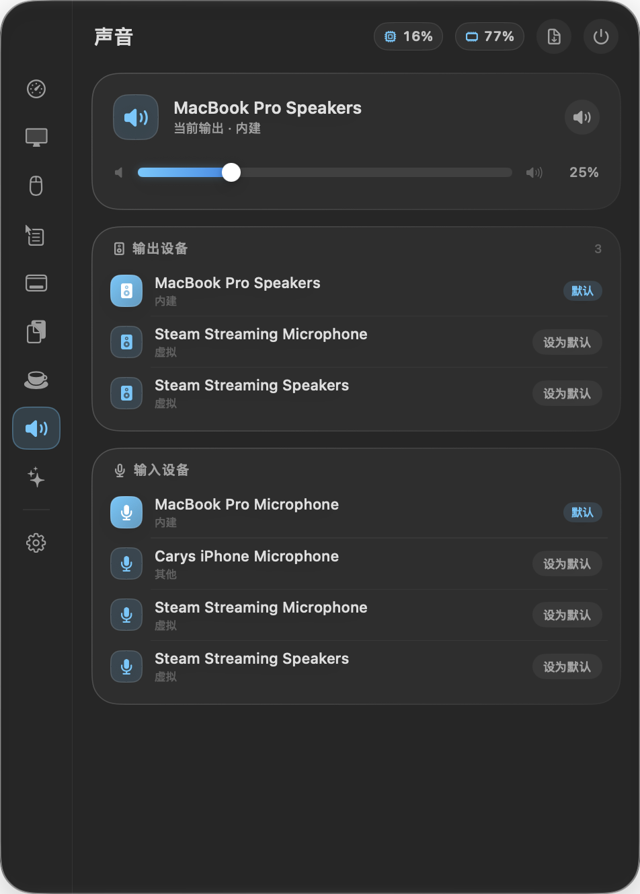
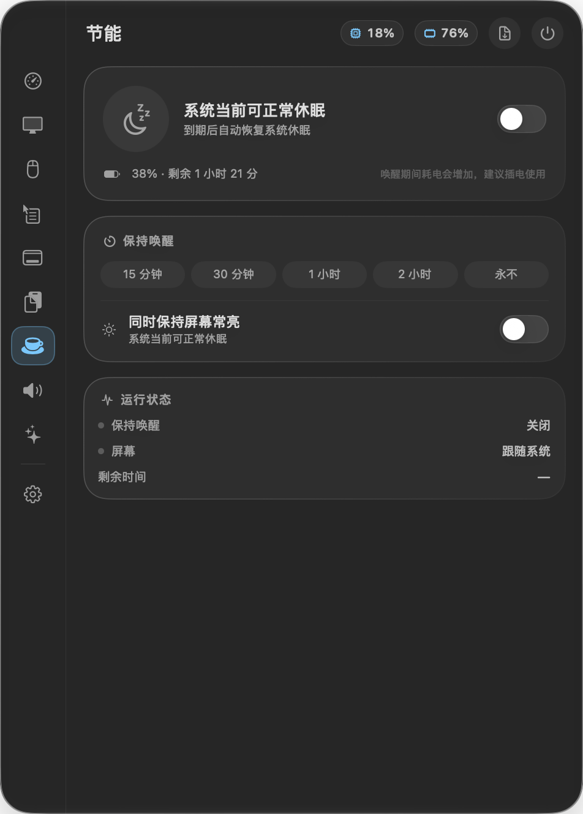
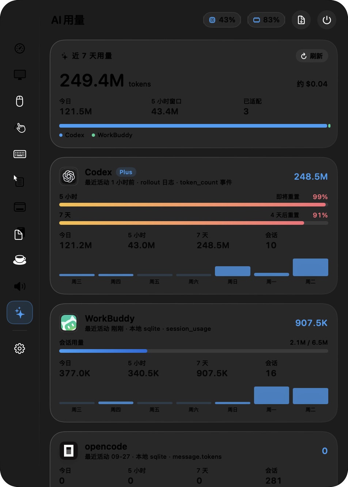
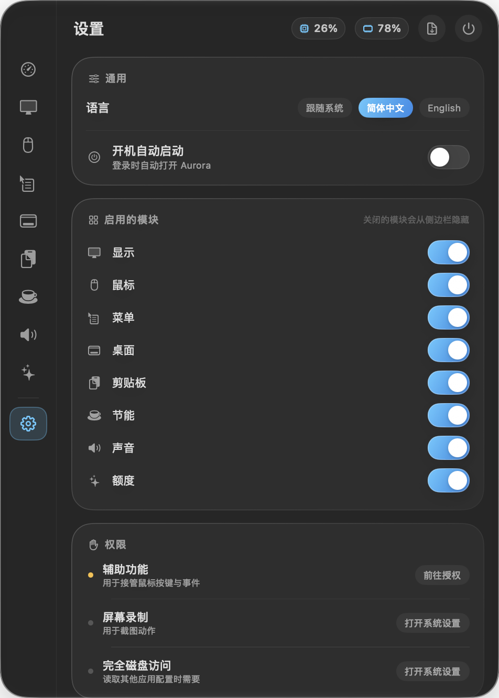

<div align="center">

# Aurora

**Everything you tweak on macOS, in one menu bar panel**

Display & screen tests · Mouse & keyboard · Input methods · Finder context menu · Clipboard · Screenshots & recording · Dynamic wallpaper · Keep-awake · Audio · Network proxy · File lock · Storage cleanup · AI usage

[](https://github.com/CaryK753/Aurora/actions/workflows/ci.yml)
[](https://github.com/CaryK753/Aurora/releases/latest)
[](LICENSE)
[](#requirements)

[简体中文](README.md) · [English](README.en.md)

</div>



## What it is

Aurora is a native macOS menu bar utility written in SwiftUI, using the Liquid Glass design of macOS 26. It gathers the things you usually do in System Settings, in a terminal, or across half a dozen tiny utilities into a single panel — one click on the menu bar icon, or **⌥⌘A**.

By default it is a floating panel that disappears when you click away. The **pin** button in the top-right corner turns it into a regular macOS window — native traffic lights in the top-left, minimizable, ⌘W closes it, and clicking elsewhere no longer dismisses it. Unpin and it goes straight back. While pinned you can also resize the window by its edges (with sensible limits), go full-screen with the green button, and the traffic lights align precisely with the interface; widen the window and module cards rearrange into two columns automatically.

The panel holds 16 feature pages. Sidebar order is drag-and-drop, and **Settings** lets you switch off the modules you never use. **Recording, input methods and network** are still marked Beta: they work, but they are still moving.

Three rules shaped the implementation:

- **Use the system APIs that actually exist.** No invented numbers — for example, there is no public per-process GPU API, so Aurora does not fake one.
- **Data stays on device.** Usage statistics are read from local logs; subscriptions and passwords never leave `~/Library/Application Support/Aurora`, and nothing is uploaded.
- **Interception is reversible.** Wheel, volume, hotkey and system-proxy takeovers are released the moment you flip the switch or quit the app.

Dynamic wallpaper renders on the desktop layer (above Finder's wallpaper, below desktop icons) and ignores all mouse clicks, so it never gets in the way; quitting Aurora or flipping the switch restores the system wallpaper untouched. The lock and login screens still belong to macOS. Both output paths stay single-file: screenshots land on the clipboard or in a folder, and a recording is always one MP4.

## Features

| Module | What it does |
| --- | --- |
| **Overview** | CPU (per core + graph), GPU, memory breakdown, network (VPN status + speed test), disk capacity and read/write throughput, battery health and cycle count. **External devices** lists Bluetooth and USB hardware — Apple devices get their own icons and real model names, AirPods report left/right/case levels, external volumes show usage. Top processes can be sorted by CPU, GPU, memory or network |
| **Display** | Built-in brightness, DDC/CI brightness · volume · contrast for external monitors, brightness presets with smooth transitions, resolution switching, restore on launch, **⌃⌥↑/↓ global brightness**; **screen tests** cover solid colours, grey steps, gradient, colour bars, checkerboard, grid, text and dead pixels, filling every connected display |
| **Pointer** | Every attached mouse, plus a live pointer probe; cursor speed and acceleration, wheel speed and acceleration, **smooth scrolling**, **separate reversal for mouse and trackpad**, Shift-to-horizontal, modifier inversion; **button capture mapping** — hit Capture, press a single button like Mos, then pick an action; the panel pins itself while capturing so no shortcut can close it. **Logitech mice** stay under control: DPI, SmartShift / ratchet, wheel mode, special buttons, per-device profiles with a default, and a setup wizard when a device appears. Bluetooth mice are disconnected before the Mac sleeps so they cannot wake it by accident |
| **Trackpad** | Tracking speed, tap to click, two-finger secondary click, natural scrolling, zoom/rotate, swipe between pages, three-finger drag — written straight to system preferences |
| **Keyboard** | Lists every keyboard (built-in / USB / Bluetooth, battery, VID:PID); ANSI / ISO / JIS keyboard type; a **key test** window that highlights physical keys and decodes ⌃⌥⇧⌘ combinations; **clean mode** swallows all key input; repeat delay/rate and F1–F12 function-key priority |
| **Input methods** (Beta) | Input source switching and caret indicators, per-app and per-site rules, Shift switching, custom snippets with system text-replacement import, and input-process health monitoring; **language keyboard** (German / French / Spanish / Italian) with key maps, a character cheat sheet and mistake-tracked drills |
| **Menu** | A **real custom Finder context menu** built on a FinderSync extension: copy path, open in Terminal, open with app, run command, create file, **lock / unlock** — add, edit, reorder, toggle individually, effective immediately. Also manages Quick Actions, Services and Finder extensions |
| **Desktop** | Show or hide desktop icons, hide files and extensions, restart Finder. **Dynamic wallpaper**: looping video / GIF (with head-tail trimming), four auto rules — one fixed, follow Light/Dark appearance (soft cross-fade), time-of-day schedule, shuffle; four built-in **procedural dynamic scenes** (Aurora / Waves / Glow / Sunset — no disk space, recolorable); drag-and-drop library with type filters, full-screen preview, five fill modes (fill / fit / stretch / center / tile), per-display settings; bundled Apple wallpapers (including aerial videos the system has downloaded), an online sources section (Unsplash / Pixabay / Wallhaven / NASA / Coverr) and download-by-URL; playback pauses on lock screen, screensaver, display sleep, system sleep, full-screen apps and low battery, holding the last frame instead of going black |
| **Clipboard** | Six record types — text, rich text, link, image, file, colour; search, filter, pinning, duplicate merging with counts, keyboard copy/paste, paste as plain text, edit and detail views; ignore rules for confidential types, apps, regex and one-shot skips; recording pauses automatically while secure input is active. The mini clipboard can anchor to the text caret |
| **Screenshots** | Area, window (hover to highlight, click to capture the whole window), full screen and scrolling capture; global ⌥⌘S. The editor ships 13 tools (select/move, pen, line, arrow, rectangle, filled rectangle, ellipse, highlighter, gaussian blur, mosaic, spotlight, step counter, text), snapshot-based undo/redo, Apple device bezels with automatic model detection, and AirDrop to an iPhone or iPad for markup, then retrieve the result |
| **Recording** (Beta) | Record a whole display, a specific window, or a dragged region; system audio and microphone are mixed into a single audio track in one MP4 — never more than one output file. Pause/resume remaps timestamps so the result has no gaps and audio stays in sync. Picture-in-picture camera bubble (rounded rectangle by default; drag to move, drag a corner to resize, right-click for shape / size / mirror / camera), mouse-click highlights and live keystrokes. Frame rate, H.265/H.264, native Retina pixels, pointer visibility; ⌥⌘R toggles recording and a draggable floating bar lets you switch sources |
| **Energy** | Keep the Mac awake from 15 minutes to 2 hours, optionally keep the display on; stop automatically under 20% battery; start at login; **remember the state** — if keep-awake was still on when you quit, the next launch restores it (optional) |
| **Audio** | Input/output device switching, volume and mute, **per-app volume** (0–150%) |
| **Network** (Beta) | Configure a proxy and write it into macOS system proxy settings: **global / rule / direct** outbound, multiple subscriptions, policy groups (manual / url-test / fallback), rule sets and a rule tester, a Surge-style dashboard (live rates, connections, engine logs) plus **Tailscale mesh**. See [Network proxy](#network-proxy) |
| **Storage** | Three tabs: **Clean** (disk usage, caches / logs / Xcode / simulator / Homebrew / Trash with per-item checks, **universal binary thinning** (real icons, per-item and select-all), large files, CLI tool entry points), **Apps** (installed apps by size; uninstalling also collects caches, preferences, containers and login items — all into the Trash), **Dev** (13 package-manager caches plus node_modules / target / .build artifacts). Everything goes to the Trash; `brew` / `docker` / `mole` / `ncdu` are only detected and offered as "Run in Terminal" — no third-party binaries are bundled |
| **AI usage** | Per-harness adapters: Codex (rollout logs plus real quota windows), Claude Code, opencode, WorkBuddy, Cursor and more; desktop clients are detected and reported honestly. Aggregates the last 7 days, today and the 5-hour window |
| **Settings** | Language (system / Chinese / English), appearance, launch at login, module toggles, live permission checks, automatic updates, GitHub entry and reset |

## Network proxy

macOS offers two ways to take over traffic, and Aurora supports both — but defaults to the one that actually works without a paid account:

- **System proxy** (default): no Apple Developer Program required. It writes the proxy into every enabled network service, so any app that follows system proxy settings goes through it. The engine is **mihomo** (pinned to `v1.19.34`) and is *not* shipped in the app bundle: on first use in a proxy mode Aurora downloads the build for your architecture, verifies the official SHA-256, confirms it runs, and only then keeps it on disk. Delete or reinstall it any time; **direct mode never needs the engine**.
- **Network extension** (optional): needs a provisioning profile carrying `app-proxy-provider-systemextension`, which requires the Apple Developer Program. Passing `AURORA_NE_PROFILE` to `build.sh` is what makes Aurora ship `AuroraTunnel.systemextension` and request the entitlement; without it the app does not request the entitlement at all (requesting it gets the process killed) and the UI disables the entry. This version's tunnel only handles TCP — UDP and DNS keep their normal path.

Subscriptions can be imported from a URL or a local file: Clash YAML / JSON (inline `proxies`, YAML aliases, basic `rules`), Shadowrocket (link lists, Base64, basic `[Proxy]`) and common share links, covering SS (SIP002 and legacy Base64), SSR, VMess, VLESS, Trojan, HTTP(S), SOCKS5, Hysteria2 and TUIC with the usual TLS / WebSocket / gRPC / Reality parameters. Downloads are capped at 5 MB and 60 seconds and check the status code; a failed update never replaces existing nodes. Keep several subscriptions side by side, each with its own refresh interval (6 hours / daily / 3 days). Node latency is measured by the engine itself, and there is a download speed test; the policy group can be manual, url-test or fallback. Surge import, external providers, scripts and proxy chains are not imported.

Rule mode resolves in this order: custom rules → `gov.cn` domains → LAN → mainland IPs → subscription rules → your fallback (direct or proxy). Mainland direct routing uses APNIC's `CN` allocations (HK / MO / TW excluded) and matches the resolved destination IP; the database is cached for 7 days, can be refreshed manually, and falls back to the previous copy on failure. Without a usable database, rule mode will not pretend to support mainland bypass. Custom rules accept DOMAIN, DOMAIN-SUFFIX, DOMAIN-KEYWORD, IP-CIDR, IP-CIDR6, PROCESS-NAME, PROCESS-PATH, DST-PORT, SRC-PORT, NETWORK and MATCH with DIRECT / PROXY / REJECT actions; unparsable lines are reported with their line number.

Before anything is written, Aurora proves it works: start the engine → use `lsof` to confirm the listening port belongs to that process → SOCKS handshake → fetch `generate_204` through the selected node. Only then does it touch system proxy settings; on failure it stops the engine and leaves the original configuration alone. System proxy settings are written in a SystemConfiguration transaction, and the backup lives in preferences, so it **survives restarts**. Restoring first checks that the current values are still the ones Aurora wrote — if another tool changed them, it stops rather than overwrite. Quitting restores automatically; if a network operation is still running or restoring fails, quitting is held back.

The panel itself is a small dashboard: a status bar with the mode and a live rate graph, then **Overview / Connections / Rules / Logs**. Connections show domain, process, matched rule and policy, per-connection traffic and duration, and can be closed one by one or all at once; Logs streams engine output with level filters. All of it comes from a controller that only listens on a local Unix socket — no TCP port, and polling stops while the panel is closed.

**Subscriptions and rules:** several subscriptions can coexist and switching only swaps the node pool, each with its own schedule. Policy groups can be manual, url-test or fallback; node latency comes from the engine and there is a one-click download speed test. The rule chain shows the engine's real order with hit counts and origins, and the rule tester tells you which rule a domain hits and where it ends up — IP, rule-set and process rules are marked "cannot judge locally" instead of guessed.

**Tailscale mesh:** with the official app installed Aurora drives its CLI for status, on/off and exit nodes; with only the OSS `tailscaled` (e.g. `brew install tailscale`) Aurora starts its own userspace instance and exposes a local SOCKS5, so rules can send `ts.net` and your own domains through the mesh while the rest keeps using the proxy. When neither exists it only offers install guidance — no fake switch.

Known limits: this only affects apps that follow system proxy settings; it does not capture all UDP or system DNS and never rewrites macOS DNS. The engine listens on `127.0.0.1` only — no TUN, no LAN access, no controller port. Subscription URLs, passwords and resolved configs stay in `~/Library/Application Support/Aurora/Network/` (directory 0700, files 0600); nothing goes through a third-party converter and error messages never echo the original URL. Tailscale integration is planned for a later release.

Full support matrix, privacy notes and verification commands live in the [network module notes](docs/network-proxy.md) (Chinese).

## Language keyboard

Learning German, French or Spanish on a Chinese or English keyboard is rarely about vocabulary — it is **how to type the special characters** and **which keys moved**. The Input methods page splits those two problems:

- **Key map** reads the real German / French / Spanish / Italian layouts from macOS and draws what every physical key actually produces (German Z ↔ Y, French A/Q and Z/W, Spanish ñ on the semicolon key, Italian è/ò/à on the right-hand punctuation keys), followed by a one-line summary of what differs from an English keyboard. It is not a drawing: if Apple changes a layout, the map follows.
- **Character cheat sheet** derives the chords from the local ABC layout — ä is `⌥U` then A, ß is `⌥S`, é is `⌥E` then E, ç is `⌥C` — and clicking a character copies it.
- **Practice** drills 14 words chosen for this language's hardest characters (Größe, français, pingüino…), shows the chord for the next character while you type, advances on a correct word and records accuracy, speed and **your most frequent mistakes**, which stay marked on the key map next time.

One Italian trap: the macOS input source named “Italian” is the everyday QWERTY one — its internal ID is oddly `Italian-Pro` — while “Italian – QZERTY” copies the old typewriter with Z and W swapped and M beside L. Aurora reads the former and labels it `Italian`, so you are not sent looking for an ID that does not exist in System Settings.

Everything happens inside Aurora's own window: no global key capture, no changing your system input source, and therefore no extra permissions.

## File lock

Right-click a file or folder in Finder → **Lock**: the contents are encrypted in place, and **Unlock** asks you to authenticate. It does not flip permission bits — the owner can bypass those — it removes the plaintext from disk. AES-GCM in 1 MB chunks (8 GB ceiling), the key lives in your login keychain, and a locked file starts with `AURL`, so other apps only ever see ciphertext. A folder becomes a **single** encrypted file and is restored as a whole tree on unlock.

- Each action asks for your Mac password or Touch ID; a multi-selection is authenticated once.
- `/`, your home directory, `/System`, `/usr`, `/bin`, `/sbin`, `/Library`, `/private`, `/Applications`, `~/Library` and sensitive folders are refused, as are `.app` / `.appex` bundles.
- The first lock explains the risks; after that it stays quiet. Batch results report how many succeeded or failed, and locked items get a lock badge.
- Opening ciphertext in its original app shows garbage — **saving from there destroys the ciphertext and the file can no longer be unlocked**. Moving to another Mac, or deleting the `com.cary.aurora.file-lock` keychain item, makes it unrecoverable too.

## Screenshots

| Display | Pointer | Keyboard |
| --- | --- | --- |
|  |  |  |

| Clipboard | Menu | Audio |
| --- | --- | --- |
|  |  |  |

| Energy | AI usage | Settings |
| --- | --- | --- |
|  |  |  |

## Requirements

- **macOS 26 or later** (the panel uses `NSGlassEffectView`)
- Apple Silicon and Intel are both supported; official builds are universal

## Installation

### Download a build (recommended)

1. Grab `Aurora-<version>.zip` from [Releases](https://github.com/CaryK753/Aurora/releases/latest).
2. Unzip it and drag `Aurora.app` into **Applications**.
3. Grant the permissions you need (next section).

#### "Aurora is damaged and can't be opened"

The build is not notarised by Apple, so on a Mac with Gatekeeper enabled you may see:

> "Aurora" is damaged and can't be opened. You should move it to the Trash.

The download is **not actually corrupted** — it just carries the quarantine attribute. Clear it from Terminal:

```bash
sudo xattr -c /Applications/Aurora.app
```

Then open the app again (the first launch may still need **right-click → Open** in Finder). Adjust the path if you installed it somewhere else. If you prefer to remove only the quarantine flag and keep other extended attributes:

```bash
sudo xattr -dr com.apple.quarantine /Applications/Aurora.app
```

> The build is signed with a fixed certificate but not notarised — the usual trade-off for open-source projects without a paid developer account. It does not make the app less safe; building from source is equally supported, and the command above applies to local builds too.

### Build from source

Requires Xcode 26 or newer (Swift 6.2+).

```bash
git clone https://github.com/CaryK753/Aurora.git
cd Aurora
./build.sh                 # build, sign and install to /Applications/Aurora.app
```

Useful flags:

```bash
AURORA_INSTALL=0 ./build.sh release       # package only
AURORA_UNIVERSAL=1 ./build.sh release     # arm64 + x86_64
AURORA_VERSION=1.4.0 AURORA_BUILD=10 ./build.sh release
AURORA_SIGN_ID="Apple Development: ..." ./build.sh release
AURORA_NE_PROFILE=/path/to/profile.mobileprovision ./build.sh release   # bundle the network extension
```

Without `AURORA_SIGN_ID`, the script uses a local developer certificate when available and falls back to ad-hoc otherwise. Signing with a stable identity avoids the classic "granted in System Settings but the app still says no" problem: TCC records grants per signature, and ad-hoc builds change their cdhash on every rebuild.

`AURORA_NE_PROFILE` is the network-extension switch: without it the app does not request the Network Extension entitlement and does not bundle the system extension, leaving only system proxy mode (this is how the official build ships). The repo also carries `Resources/AuroraWithNetwork.entitlements` and `Resources/AuroraTunnel.entitlements`, which are only useful with your own signing setup.

## First launch and permissions

The first launch walks you through three steps: what Aurora does, which modules to enable, and the permissions you need.

| Permission | Used for | Required |
| --- | --- | --- |
| Accessibility | Pointer interception, side buttons, simulated paste and keystrokes | Pointer module |
| Screen Recording | Screenshot actions, window previews | Screenshot features only |
| Input Monitoring | Raw buttons from external mice | External mouse macros only |
| Full Disk Access | Reading other apps' settings and local usage databases | Optional |
| Notifications | Instant alerts for new versions, finished recordings, saved screenshots, lock results and finished breaks | Optional |
| Camera | Records your camera into the video for picture-in-picture | Optional |
| Microphone | Adds a second audio track from the microphone | Optional |

Permission state is re-checked every 3 seconds and can be refreshed manually from **Settings › Permissions**. If the system says a permission is granted but Aurora disagrees, remove the old Aurora entry and add `/Applications/Aurora.app` again.

A few things bypass TCC entirely:

- **File lock** needs none of the permissions above, but it does need the login keychain. Authentication uses your Mac password / Touch ID, and cancelling changes nothing.
- **Applying a system proxy** asks for administrator authorisation because it edits system network settings. Declining or failing to commit never leaves a half-applied state — the UI asks you to restore the backup first, then retry.
- **The network extension** must be allowed in **System Settings › General › Login Items & Extensions**, and the build itself must carry the right provisioning profile — otherwise Aurora never appears in the VPN list.

## Shortcuts and gestures

| Action | Notes |
| --- | --- |
| **⌥⌘A** | Open / close the panel (works even when the menu bar icon is hidden) |
| **⌃⌥↑ / ⌃⌥↓** | Raise or lower the main display brightness by 6% without opening the panel |
| **⌘ + drag a sidebar icon** | Reorder modules; drop outside the panel to be asked whether to disable it |
| **⌘1 – ⌘9** | Copy a pinned clipboard entry (add ⌥ to paste into the previous app) |
| **⌃⌥⌘K** | Leave keyboard clean mode |
| **⇧⌘V** | Open the mini clipboard (↑↓ to select, ⏎ to paste, ⌘1–9 to paste directly, ⌘⌫ to delete) |
| **⌥⌘S** | Area screenshot, straight into the annotation editor |
| **⌥⌘R** | Start / stop screen recording |
| **ESC** | Close the panel, exit a screen test, or cancel a button capture |
| **⌘W / ⌘M** | Close / minimize once the panel is pinned as a window |

The ⌘ button at the bottom of the sidebar opens the **Global shortcuts** page, where the first four hotkeys can be re-recorded and take effect immediately.

## Automatic updates

The built-in updater reads this repository's GitHub releases:

- Checks for the latest release **every hour** by default and downloads it automatically.
- Once downloaded, Aurora asks before doing anything: confirm to replace `Aurora.app` and relaunch, or choose "Later" and update whenever you want.
- The prompt shows only the current version, package size and four highlights — HTML and Markdown in the release body are converted to plain text, so no stray tags.
- The first launch after an update opens a What's New window describing that version (read from the bundled `CHANGELOG.md`, so it works offline). Each version is shown once; reopen it any time from **Settings › About › What's New**.
- You can also run a manual check from **Settings › About**, or turn automatic updates off and keep manual checks.
- A downloaded package is checked for repository, version, asset name, SHA-256, bundle ID, signing team and version increase; if any check fails, nothing is installed.
- Only the app bundle is replaced. Settings, clipboard history, subscription configs and custom menu items live in `~/Library/Application Support/Aurora` and are never touched.
- Official builds use the **same fixed certificate** as local source builds (CI imports `AURORA_CERT_P12` / `AURORA_CERT_PASSWORD` / `AURORA_SIGN_ID` from repository secrets into a temporary keychain before packaging). TCC identifies an app by its designated requirement, and that requirement follows the certificate — so **permissions survive updates**; they only need re-granting if the certificate itself changes or is renewed.

> **Upgrading from 1.5.0 or earlier:** those builds read the signing team from the wrong place (the string in the certificate's display name instead of the certificate OU), so they reject a correctly signed package as "wrong signing team". From 1.5.5 on, the real TeamIdentifier is used — **move from 1.5.0 to 1.5.5 by downloading the package once**; automatic updates work normally afterwards.

## Project layout

```
Sources/
├── Aurora/                      The app (SwiftUI + AppKit)
│   ├── main.swift               Entry point and CLI tools
│   ├── AppDelegate.swift        Menu bar, hotkeys, lifecycle
│   ├── PanelController.swift    Liquid Glass floating panel
│   ├── AppState.swift           Global state and service wiring
│   ├── Module.swift             Module registry
│   ├── Core/                    Service implementations (network and file lock live here too)
│   ├── UI/                      Panel, module views, component library
│   └── SelfTest.swift           Self-checks and diagnostics
├── AuroraFinder/                FinderSync context-menu extension (signed separately, sandboxed)
├── AuroraTunnel/                Transparent-proxy system extension (optional, needs a profile)
└── NetworkProxyKit/             Subscription parsing, rule generation, engine manifest (pure logic, unit tested)
Modules/
├── LogitechPlugin/              Logitech HID++ device plugin (with unit tests)
└── LanguageLayoutPlugin/        Language layouts, chords and drill engine (with unit tests)
Resources/                       Icons, entitlements, network third-party notices
Tests/                           Regression scripts; NetworkProxyKit / SystemProxy have their own tests
Tools/                           Icon and device-frame generators
docs/                            Screenshots, architecture, performance and network notes
```

`build.sh` does the packaging: it builds the SwiftPM targets, assembles the `.app`, compiles the Finder extension by hand with `swiftc -e _NSExtensionMain`, compiles the network extension when a profile is supplied (merging both slices for universal builds), and signs every bundle from the inside out.

## Development and testing

```bash
swift build                      # build
swift test                       # unit tests: LogitechPlugin + NetworkProxyKit + LanguageLayoutPlugin
swift test --filter 'SubscriptionTests|RoutingTests|DownloadTests'
swift test --filter LanguageLayoutPluginTests

bash Tests/Behavior/run.sh       # wallpaper playback policy, recording, desktop
bash Tests/Functional/run.sh     # energy, display, audio, DDC
bash Tests/Panel/run.sh Tests/Preferences/run.sh Tests/Permissions/run.sh
bash Tests/Input/run.sh Tests/Macros/run.sh
bash Tests/SystemProxy/run.sh    # system-proxy backup and restore conflict checks
bash Tests/Localization/run.sh   # duplicate translation keys (they crash the English UI at launch)
bash Tests/NetworkProxyKit/run-integration.sh   # downloads the engine and APNIC data, talks only to a local test server
```

The app itself ships a set of self-check entry points; each runs and exits:

```bash
Aurora --selftest                # capability overview: displays, sampling, permissions, GPU, audio, usage, menu
Aurora --file-lock-test          # file-lock encrypt/decrypt round trip and damage detection
Aurora --scroll-test             # wheel transforms: speed / reverse / Shift-horizontal / modifiers / residuals
Aurora --clip-e2e                # clipboard end-to-end: dedupe, RTF on disk, image on disk
Aurora --keyboard-clean-test     # clean-mode interception and unlock
Aurora --device-test             # enumerate keyboards and pointing devices
Aurora --update-test             # read the latest GitHub release and compare versions, no download
Aurora --update-test --download  # also download and unpack (no prompt, no install)
Aurora --notes-report            # parse CHANGELOG / release body, check the What's New window
```

When changing UI, offscreen rendering beats taking screenshots by hand:

```bash
./.build/debug/Aurora --render network out.png dark          # one module → PNG
./.build/debug/Aurora --snapshot network out.png light       # real window snapshot (use this for docs)
```

Implementation notes are in [docs/ARCHITECTURE.md](docs/ARCHITECTURE.md); measurement method and numbers are in [docs/PERFORMANCE.md](docs/PERFORMANCE.md) (sampled on 1.3.0).

## Continuous integration

| Workflow | Trigger | What it does |
| --- | --- | --- |
| [`ci.yml`](.github/workflows/ci.yml) | push / PR | Build, unit tests, package the `.app`, verify the signature, keep the artifact for 7 days |
| [`release.yml`](.github/workflows/release.yml) | `v*` tag or manual dispatch | Build the universal binary, produce the zip and SHA-256 checksum, publish a GitHub release |

Cutting a release:

```bash
git tag v1.5.5
git push origin v1.5.5
```

The release body is lifted straight from the matching section of `CHANGELOG.md`, so fill that section in first — the in-app What's New window reads exactly the same text.

## Contributing

Issues and pull requests are welcome.

- Make sure `swift build` and `swift test` pass, and run the relevant `Tests/*/run.sh` scripts.
- When adding a module, add both Chinese and English strings (`Localization.swift` / `FeatureTranslations.swift` / `NetworkProxyTranslations.swift`) and update both feature tables.
- When touching `Package.swift` or `build.sh`, remember that `build.sh` is the only distribution path — CI and local builds run the same script.
- For changes touching system APIs, describe how you verified them and any known limitations.

## License

Released under the [MIT License](LICENSE).

The network module uses [mihomo](https://github.com/MetaCubeX/mihomo), which is not part of this repository, is downloaded on demand and keeps its own license; subscription parsing uses [Yams](https://github.com/jpsim/Yams). See [`Resources/NetworkThirdPartyNotices.txt`](Resources/NetworkThirdPartyNotices.txt).

## Acknowledgements

Interactions and feature sets were inspired by these projects — ideas and configuration semantics only, no source code copied:

[LinearMouse](https://github.com/linearmouse/linearmouse) ·
[MonitorControl](https://github.com/MonitorControl/MonitorControl) ·
[Stats](https://github.com/exelban/stats) ·
[Mos](https://github.com/Caldis/Mos) ·
[RClick](https://github.com/wflixu/RClick) ·
[Maccy](https://github.com/p0deje/Maccy) ·
[KeepingYouAwake](https://github.com/newmarcel/KeepingYouAwake) ·
[switchaudio-osx](https://github.com/deweller/switchaudio-osx) ·
[CodexBar](https://github.com/steipete/CodexBar) ·
[usage](https://github.com/aqua5230/usage) ·
[QuickRecorder](https://github.com/lihaoyun6/QuickRecorder) ·
[Recordly](https://github.com/webadderallorg/Recordly) ·
[Snapzy](https://github.com/duongductrong/Snapzy) ·
[mihomo](https://github.com/MetaCubeX/mihomo)
