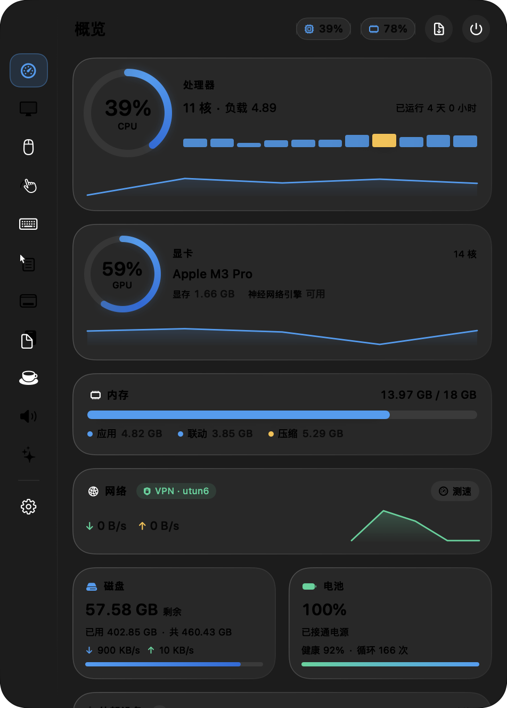
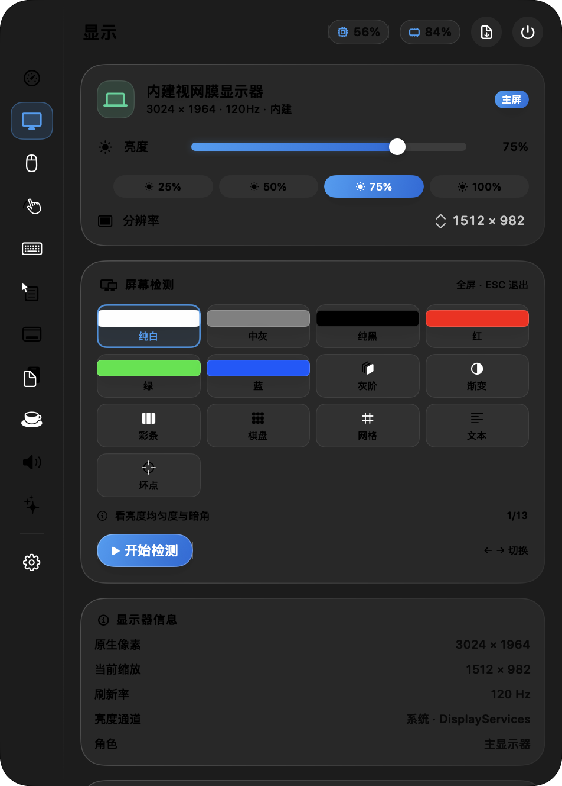
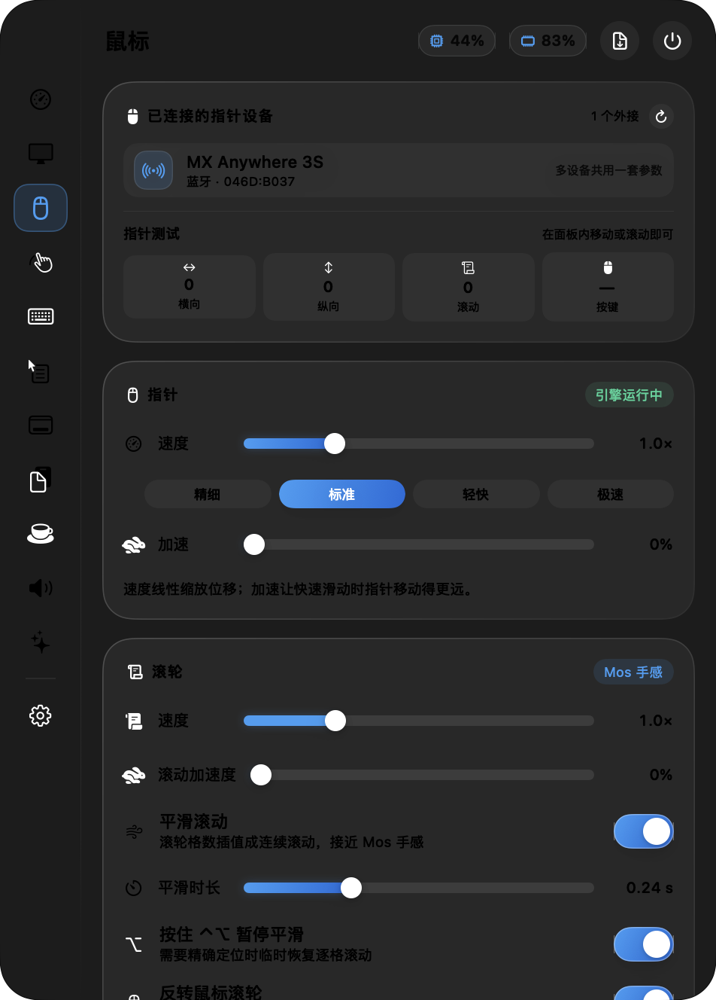
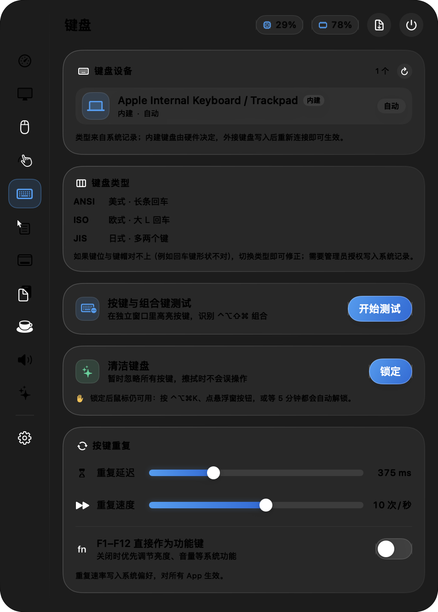
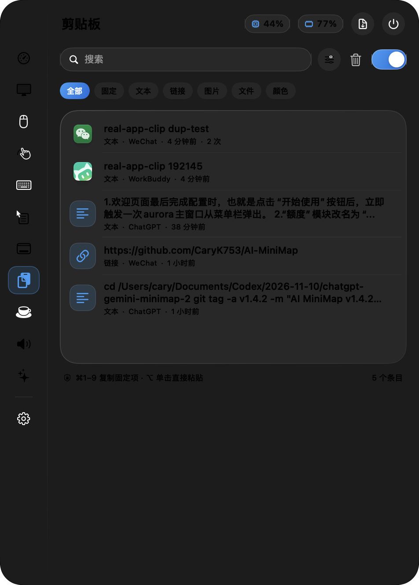
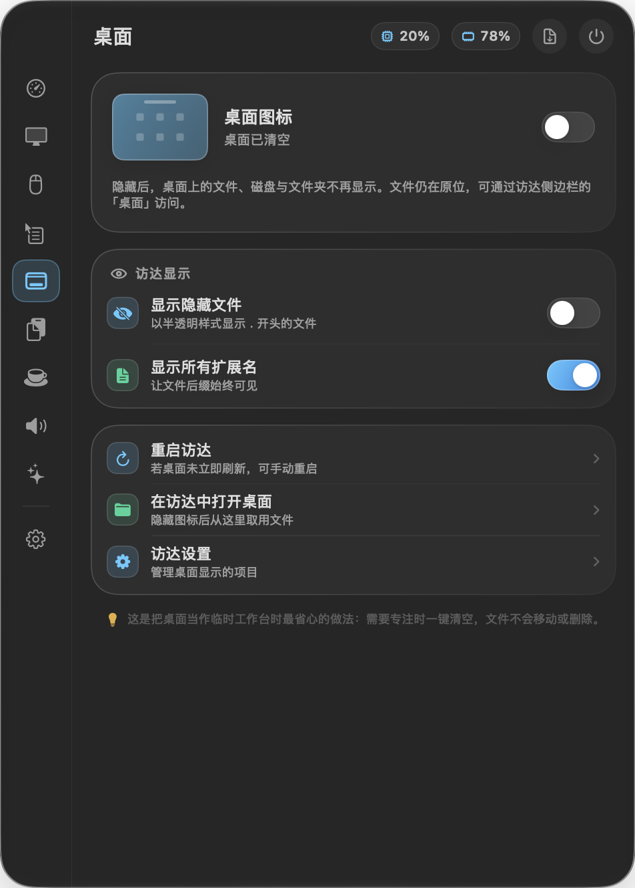
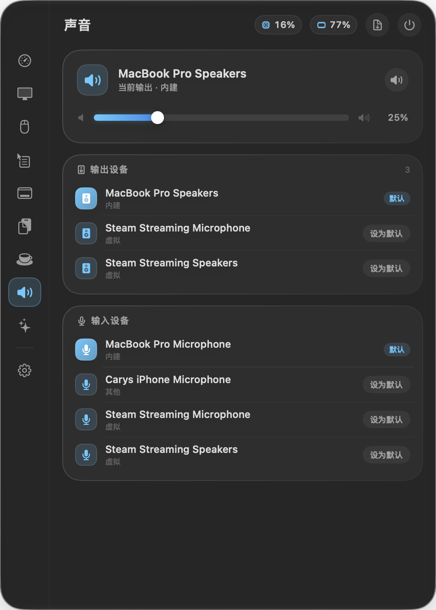
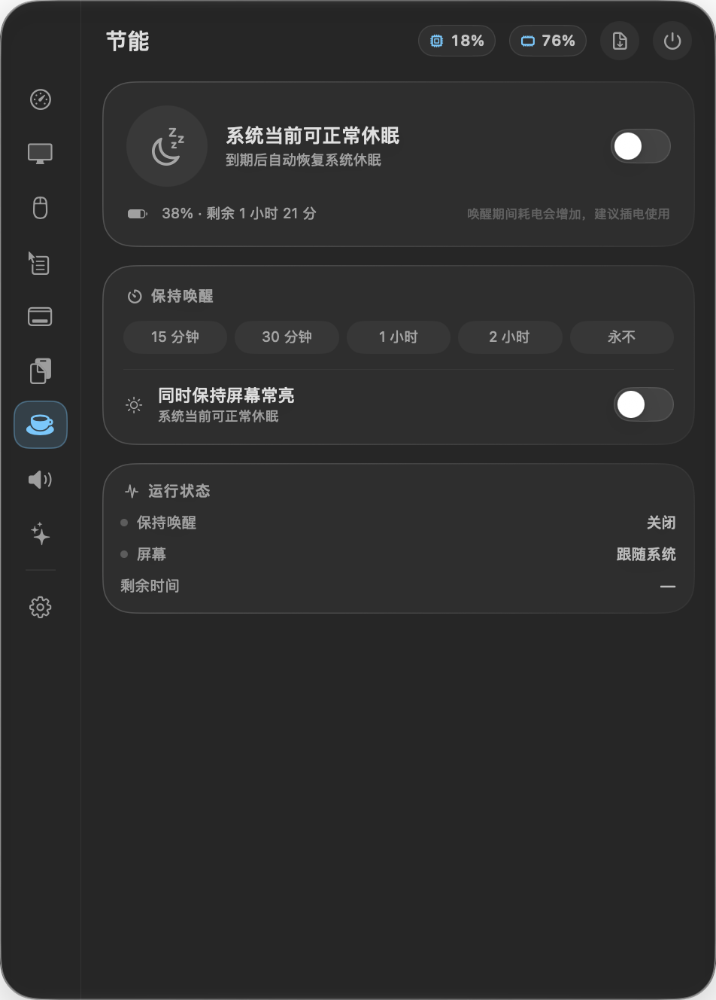
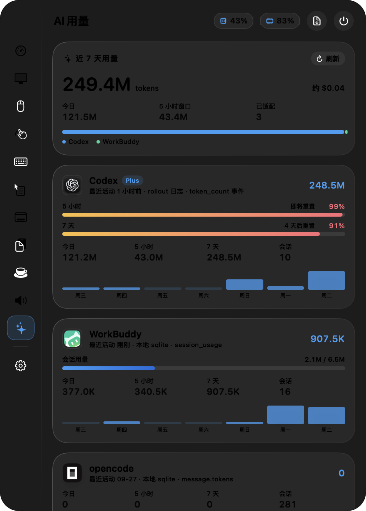
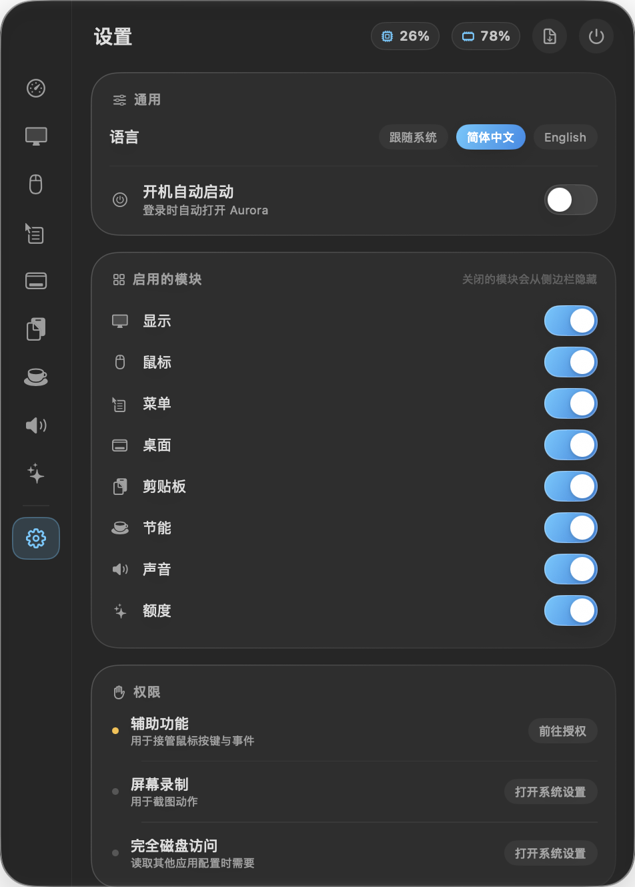

<div align="center">

# Aurora

**Everything you tweak on macOS, in one menu bar panel**

Display & screen tests · Mouse & keyboard · Finder context menu · Clipboard · Keep-awake · Audio · AI usage · External devices

[](https://github.com/CaryK753/Aurora/actions/workflows/ci.yml)
[](https://github.com/CaryK753/Aurora/releases/latest)
[](LICENSE)
[](#requirements)

[简体中文](README.md) · [English](README.en.md)

</div>



## What it is

Aurora is a native macOS menu bar utility written in SwiftUI, using the Liquid Glass design of macOS 26. It gathers the things you usually do in System Settings, in a terminal, or across half a dozen tiny utilities into a single panel — one click on the menu bar icon, or **⌥⌘A**.

Three rules shaped the implementation:

- **Use the system APIs that actually exist.** No invented numbers — for example, there is no public per-process GPU API, so Aurora does not fake one.
- **Data stays on device.** Usage statistics are read from local logs; nothing is uploaded.
- **Interception is reversible.** Wheel, volume and hotkey takeovers are released the moment you flip the switch or quit the app.

## Features

| Module | What it does |
| --- | --- |
| **Overview** | CPU (per core + graph), GPU, memory breakdown, network (VPN status + speed test), disk capacity and read/write throughput, battery health and cycle count. **External devices** lists Bluetooth and USB hardware — Apple devices get their own icons and real model names, AirPods report left/right/case levels, external volumes show usage. Top processes can be sorted by CPU, GPU, memory or network |
| **Display** | Built-in brightness, DDC/CI brightness · volume · contrast for external monitors, brightness presets with smooth transitions, resolution switching, restore on launch, **⌃⌥↑/↓ global brightness**; **screen tests** cover solid colours, grey steps, gradient, colour bars, checkerboard, grid, text and dead pixels, filling every connected display |
| **Pointer** | Every attached mouse, plus a live pointer probe; cursor speed and acceleration, wheel speed and acceleration, **smooth scrolling**, **separate reversal for mouse and trackpad**, Shift-to-horizontal, modifier inversion; side-button mapping with press-to-identify |
| **Trackpad** | Tracking speed, tap to click, two-finger secondary click, natural scrolling, zoom/rotate, swipe between pages, three-finger drag — written straight to system preferences |
| **Keyboard** | Lists every keyboard (built-in / USB / Bluetooth, battery, VID:PID); ANSI / ISO / JIS keyboard type; a **key test** window that highlights physical keys and decodes ⌃⌥⇧⌘ combinations; **clean mode** swallows all key input; repeat delay/rate and F1–F12 function-key priority |
| **Menu** | A **real custom Finder context menu** built on a FinderSync extension: copy path, open in Terminal, open with app, run command, create file — add, edit, reorder, toggle individually, effective immediately. Also manages Quick Actions, Services and Finder extensions |
| **Desktop** | Show or hide desktop icons, hide files and extensions, restart Finder |
| **Clipboard** | Six record types — text, rich text, link, image, file, colour; search, filter, pinning, duplicate merging with counts, keyboard copy/paste, paste as plain text, edit and detail views; ignore rules for confidential types, apps, regex and one-shot skips; recording pauses automatically while secure input is active |
| **Energy** | Keep the Mac awake from 15 minutes to 2 hours, optionally keep the display on; stop automatically under 20% battery; start at login |
| **Audio** | Input/output device switching, volume and mute, **per-app volume** (0–150%) |
| **AI usage** | Per-harness adapters: Codex (rollout logs plus real quota windows), Claude Code, opencode, WorkBuddy and more; desktop clients are detected and reported honestly. Aggregates the last 7 days, today and the 5-hour window |
| **Settings** | Language (system / Chinese / English), appearance, launch at login, module toggles, live permission checks, automatic updates, GitHub entry and reset |

## Screenshots

| Display | Pointer | Keyboard |
| --- | --- | --- |
|  |  |  |

| Clipboard | Menu | Audio |
| --- | --- | --- |
|  |  |  |

| Energy | AI usage | Settings |
| --- | --- | --- |
|  |  |  |

## Requirements

- **macOS 26 or later** (the panel uses `NSGlassEffectView`)
- Apple Silicon and Intel are both supported; official builds are universal

## Installation

### Download a build (recommended)

1. Grab `Aurora-<version>.zip` from [Releases](https://github.com/CaryK753/Aurora/releases/latest).
2. Unzip it and drag `Aurora.app` into **Applications**.
3. If Gatekeeper blocks the first launch, **right-click → Open** once in Finder.
4. Grant the permissions you need (next section).

> The build is ad-hoc signed and not notarised by Apple — the usual trade-off for open-source projects without a paid developer account. It does not make the app less safe; building from source is equally supported.

### Build from source

Requires Xcode 26 or newer (Swift 6.2+).

```bash
git clone https://github.com/CaryK753/Aurora.git
cd Aurora
./build.sh                 # build, sign and install to /Applications/Aurora.app
```

Useful flags:

```bash
AURORA_INSTALL=0 ./build.sh release       # package only
AURORA_UNIVERSAL=1 ./build.sh release     # arm64 + x86_64
AURORA_VERSION=1.2.0 AURORA_BUILD=120 ./build.sh release
AURORA_SIGN_ID="Apple Development: ..." ./build.sh release
```

Without `AURORA_SIGN_ID`, the script uses a local developer certificate when available and falls back to ad-hoc otherwise. Signing with a stable identity avoids the classic "granted in System Settings but the app still says no" problem: TCC records grants per signature, and ad-hoc builds change their cdhash on every rebuild.

## First launch and permissions

The first launch walks you through three steps: what Aurora does, which modules to enable, and the permissions you need.

| Permission | Used for | Required |
| --- | --- | --- |
| Accessibility | Pointer interception, side buttons, simulated paste and keystrokes | Pointer module |
| Screen Recording | Screenshot actions, window previews | Screenshot features only |
| Input Monitoring | Raw buttons from external mice | External mouse macros only |
| Full Disk Access | Reading other apps' settings and local usage databases | Optional |

Permission state is re-checked every 3 seconds and can be refreshed manually from **Settings › Permissions**. If the system says a permission is granted but Aurora disagrees, remove the old Aurora entry and add `/Applications/Aurora.app` again.

## Shortcuts and gestures

| Action | Notes |
| --- | --- |
| **⌥⌘A** | Open / close the panel (works even when the menu bar icon is hidden) |
| **⌃⌥↑ / ⌃⌥↓** | Raise or lower the main display brightness by 6% without opening the panel |
| **⌘ + drag a sidebar icon** | Reorder modules; drop outside the panel to be asked whether to disable it |
| **⌘1 – ⌘9** | Copy a pinned clipboard entry (add ⌥ to paste into the previous app) |
| **⌃⌥⌘K** | Leave keyboard clean mode |
| **ESC** | Close the panel or exit a screen test |

## Automatic updates

The built-in updater reads this repository's GitHub releases:

- Checks for the latest release **every hour** by default and downloads it automatically.
- Once downloaded, Aurora asks before doing anything: confirm to replace `Aurora.app` and relaunch, or choose "Later" and update whenever you want.
- You can also run a manual check from **Settings › About**, or turn automatic updates off and keep manual checks.
- Only the app bundle is replaced. Settings, clipboard history and custom menu items live in `~/Library/Application Support/Aurora` and are never touched.

## Project layout

```
Sources/
├── Aurora/                      The app (SwiftUI + AppKit)
│   ├── main.swift               Entry point and CLI tools
│   ├── AppDelegate.swift        Menu bar, hotkeys, lifecycle
│   ├── PanelController.swift    Liquid Glass floating panel
│   ├── AppState.swift           Global state and service wiring
│   ├── Module.swift             Module registry
│   ├── Core/                    Service implementations
│   ├── UI/                      Panel, module views, component library
│   └── SelfTest.swift           Self-checks and diagnostics
├── AuroraFinder/                FinderSync context-menu extension (signed separately)
Modules/
└── LogitechPlugin/              Logitech HID++ device plugin (with unit tests)
Resources/                       Icons and entitlements
Tests/                           Panel, preferences, permissions and functional scripts
Tools/                           Icon generator
docs/                            Screenshots and architecture notes
```

`build.sh` does the packaging: it builds the SwiftPM targets, assembles the `.app`, compiles the Finder extension by hand with `swiftc -e _NSExtensionMain`, and signs both bundles.

## Development and testing

```bash
swift build                      # build
swift test                       # unit tests (LogitechPlugin)

Aurora --selftest                # capability overview: displays, sampling, permissions, GPU, audio, usage, menu
Aurora --scroll-test             # wheel transforms: speed / reverse / Shift-horizontal / modifiers / residuals
Aurora --clip-e2e                # clipboard end-to-end: dedupe, RTF on disk, image on disk
Aurora --keyboard-clean-test     # clean-mode interception and unlock
Aurora --device-test             # enumerate keyboards and pointing devices
Aurora --update-test             # read the latest GitHub release and compare versions, no download
```

Regression scripts live in `Tests/`: `bash Tests/Functional/run.sh`, `Tests/Panel/run.sh`, `Tests/Preferences/run.sh`, `Tests/Permissions/run.sh`.

Implementation notes are in [docs/ARCHITECTURE.md](docs/ARCHITECTURE.md).

## Continuous integration

| Workflow | Trigger | What it does |
| --- | --- | --- |
| [`ci.yml`](.github/workflows/ci.yml) | push / PR | Build, unit tests, package the `.app`, verify the signature, keep the artifact for 7 days |
| [`release.yml`](.github/workflows/release.yml) | `v*` tag or manual dispatch | Build the universal binary, produce the zip and SHA-256 checksum, publish a GitHub release |

Cutting a release:

```bash
git tag v1.1.0
git push origin v1.1.0
```

## Contributing

Issues and pull requests are welcome.

- Make sure `swift build` and `swift test` pass before opening a PR.
- When adding a module, add both Chinese and English strings (`Localization.swift` / `ModuleTranslations.swift`) and update the feature table here.
- For changes touching system APIs, describe how you verified them and any known limitations.

## License

Released under the [MIT License](LICENSE).

## Acknowledgements

Interactions and feature sets were inspired by these projects — ideas and configuration semantics only, no source code copied:

[LinearMouse](https://github.com/linearmouse/linearmouse) ·
[MonitorControl](https://github.com/MonitorControl/MonitorControl) ·
[Stats](https://github.com/exelban/stats) ·
[Mos](https://github.com/Caldis/Mos) ·
[RClick](https://github.com/wflixu/RClick) ·
[Maccy](https://github.com/p0deje/Maccy) ·
[KeepingYouAwake](https://github.com/newmarcel/KeepingYouAwake) ·
[switchaudio-osx](https://github.com/deweller/switchaudio-osx) ·
[CodexBar](https://github.com/steipete/CodexBar) ·
[usage](https://github.com/aqua5230/usage)
