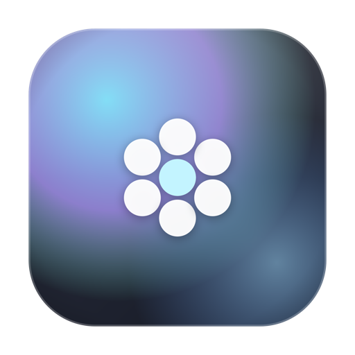

<div align="center">
  

# Aurora

**A convenient place for everyday Mac controls.**

Display, input devices, clipboard, capture, networking, and more — from your menu bar.

[Download Aurora](https://github.com/CaryK753/Aurora/releases/latest) · [Features](#features) · [Installation](#installation) · [Contributing](#contributing)

[](https://github.com/CaryK753/Aurora/actions/workflows/ci.yml)
[](https://github.com/CaryK753/Aurora/releases/latest)
[](#requirements)
[](LICENSE)

[简体中文](README.md) · English

</div>

---

Aurora is a native macOS menu bar utility built with SwiftUI and AppKit. Open the panel from the menu bar or with **⌥⌘A**, and pin it as a regular window when you need it to stay visible. Modules can be enabled and reordered to suit your workflow.

## Features

| Area | What you can do |
| --- | --- |
| **System & display** | Monitor CPU, memory, network, battery and processes; adjust built-in or compatible DDC/CI displays; test screens; manage audio devices and per-app volume. |
| **Input devices** | Adjust mouse, trackpad and keyboard settings; configure supported Logitech devices; test keys and use keyboard cleaning mode. |
| **Input & productivity** | Manage input sources and phrases; practice German, French, Spanish and Italian layouts; search and pin clipboard history; customize Finder context menus. |
| **Capture & desktop** | Capture and annotate screens or windows; record your screen; use video, GIF or generated dynamic wallpapers. |
| **Network & security** | Manage system proxy settings, subscriptions, groups and rules; use Tailscale; encrypt files and folders from Finder. |
| **Maintenance & more** | Clean storage, manage apps and development artifacts, keep your Mac awake, and view locally recorded AI usage for supported tools. |

Input methods, screen recording and networking are marked **Beta**. Availability depends on your macOS version, hardware, permissions and build configuration. See the [network documentation](docs/network-proxy.md) for supported features and limitations.

## Requirements

- macOS 26 or later.
- Apple Silicon or Intel. Official packages are universal binaries.

## Installation

1. Download the latest `Aurora-<version>.zip` from [Releases](https://github.com/CaryK753/Aurora/releases/latest).
2. Unzip it and move `Aurora.app` to Applications.
3. Open Aurora, choose the modules you need and grant permissions as prompted.

### First launch

The release may not be notarized by Apple, so macOS may prevent it from opening. First, make sure the archive came from this repository's release page and check it against the matching `.sha256` file:

```bash
cd ~/Downloads
shasum -a 256 -c Aurora-<version>.zip.sha256
```

Replace `<version>` with the actual version and run the command in the directory containing the downloaded files. A checksum checks the downloaded content; by itself it does not establish that the source is trustworthy. If macOS still blocks the app, review the message under System Settings → Privacy & Security, or [build from source](#build-from-source). A “damaged” message alone is not proof that a file is safe.

### Upgrading from older versions

The updater in version 1.5.0 and earlier may incorrectly reject the signing team. When upgrading from those versions, download and install a newer release manually first. Back up important data before upgrading.

## Permissions & data

Aurora requests permissions for the features that need them. You can review and manage them in the app.

| Permission | Example use |
| --- | --- |
| Accessibility | Mouse button mappings and simulated key presses or paste |
| Screen & System Audio Recording | Screenshots, recording and previews |
| Input Monitoring | Reading raw buttons on external mice |
| Full Disk Access | Optional; reading some local app configuration or usage data |
| Notifications, Camera, Microphone | Optional; notifications and recording features |

Settings, clipboard history and network subscriptions are stored locally. Network features may download the proxy core, subscriptions or rule data as needed. The system proxy affects apps that respect macOS proxy settings; it does not guarantee interception of all traffic. See the [network documentation](docs/network-proxy.md) for details.

> **File lock:** Encryption depends on a key in the current Mac's login keychain. Deleting the key, changing devices or overwriting an encrypted file can make recovery impossible. Keep an independent backup before use.

## Keyboard shortcuts

| Shortcut | Action |
| --- | --- |
| `⌥⌘A` | Show or hide the main panel |
| `⇧⌘V` | Open the mini clipboard |
| `⌥⌘S` | Capture a region |
| `⌥⌘R` | Start or stop screen recording |
| `⌃⌥↑ / ⌃⌥↓` | Adjust the main display's brightness |
| `⌃⌥⌘K` | Exit keyboard cleaning mode |

Configure shortcuts from the ⌘ page at the bottom of the panel sidebar. Some actions require the relevant permissions.

## Build from source

Xcode 26 or later and Swift 6.2 or later are required.

```bash
git clone https://github.com/CaryK753/Aurora.git
cd Aurora
AURORA_INSTALL=0 ./build.sh release
```

The result is `build/Aurora.app`. The environment variable prevents automatic installation; without it, the script installs to `/Applications` by default. Add `AURORA_UNIVERSAL=1` for a universal build. See [build.sh](build.sh) and the [architecture notes](docs/ARCHITECTURE.md) for signing and optional network extension configuration.

## Development & testing

```bash
swift build --disable-sandbox
swift test --disable-sandbox
bash Tests/Localization/run.sh
bash Tests/SystemProxy/run.sh
```

Some integration tests require network access, additional dependencies or macOS permissions. For related changes, run the applicable scripts under `Tests/` and describe your test environment.

- [Architecture](docs/ARCHITECTURE.md)
- [Network proxy](docs/network-proxy.md)
- [Performance measurements](docs/PERFORMANCE.md) (historical version)
- [Changelog](CHANGELOG.md)

## Contributing

Bug reports and suggestions are welcome in [Issues](https://github.com/CaryK753/Aurora/issues), as are pull requests. Please include your macOS and Aurora versions, reproduction steps, and logs or screenshots with sensitive information removed. Check both Chinese and English translations when changing interface copy.

## License & acknowledgements

Aurora is released under the [MIT License](LICENSE). Third-party components and their licenses are listed in [NetworkThirdPartyNotices.txt](Resources/NetworkThirdPartyNotices.txt); mihomo is downloaded separately when needed.

Aurora draws inspiration from [LinearMouse](https://github.com/linearmouse/linearmouse), [MonitorControl](https://github.com/MonitorControl/MonitorControl), [Stats](https://github.com/exelban/stats), [Mos](https://github.com/Caldis/Mos), [RClick](https://github.com/wflixu/RClick), [Maccy](https://github.com/p0deje/Maccy), [KeepingYouAwake](https://github.com/newmarcel/KeepingYouAwake), [switchaudio-osx](https://github.com/deweller/switchaudio-osx), [CodexBar](https://github.com/steipete/CodexBar), [usage](https://github.com/aqua5230/usage), [QuickRecorder](https://github.com/lihaoyun6/QuickRecorder), [Recordly](https://github.com/webadderallorg/Recordly), [Snapzy](https://github.com/duongductrong/Snapzy) and [mihomo](https://github.com/MetaCubeX/mihomo).
