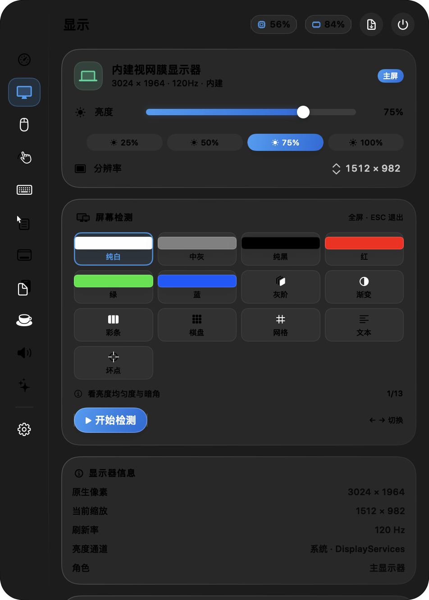
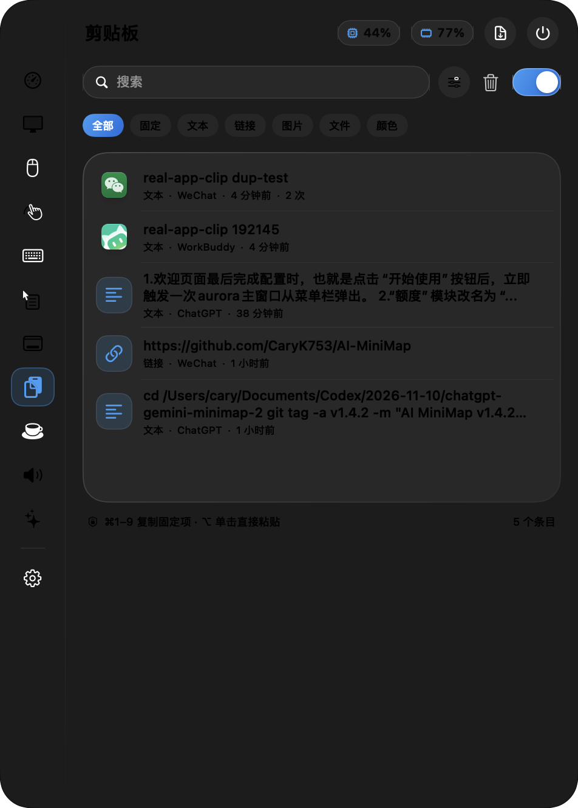
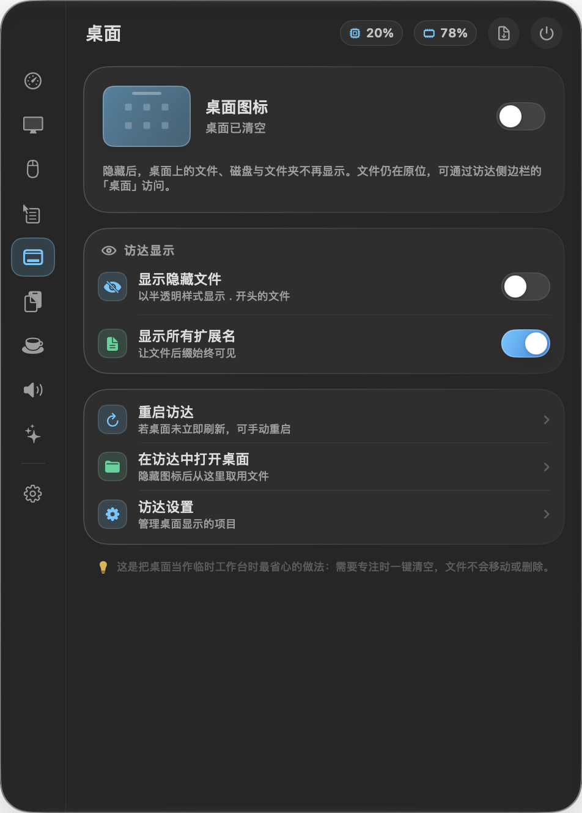

<div align="center">

# Aurora

**把 macOS 的日常设置，收进一个菜单栏面板**

显示器与屏幕检测 · 鼠标与键盘 · 输入法 · 右键菜单 · 剪贴板 · 截图与录屏 · 动态壁纸 · 节能 · 声音 · 网络代理 · 文件锁 · 存储清理 · AI 用量

[](https://github.com/CaryK753/Aurora/actions/workflows/ci.yml)
[](https://github.com/CaryK753/Aurora/releases/latest)
[](LICENSE)
[](#系统要求)

[简体中文](README.md) · [English](README.en.md)

</div>


## 简介

Aurora 是一个常驻菜单栏的原生 macOS 工具，用 SwiftUI 写成，界面是 macOS 26 的液态玻璃（Liquid Glass）。它把平时散落在「系统设置」、终端命令和一堆小工具里的操作合并到一个面板：点一下菜单栏图标，或者按 **⌥⌘A**。

默认是个点外面就收起的浮动面板；右上角的 **固定** 按钮可以让它变成正经的 macOS 窗口——左上角换成系统红绿灯，能最小化、能按 ⌘W 关掉，点别处也不会消失。取消固定立刻变回去。固定状态下窗口可以拖边缘调整大小（有上下限），绿钮进入 macOS 原生全屏，红绿灯与界面元素精确对齐；窗口拉宽后各模块卡片自动排成两列，充分利用空间。

面板里有 16 个功能页，侧栏顺序可拖动调整，「设置」里能单独关掉用不上的模块。**录屏、输入法、网络** 三个模块仍标着 Beta——能用，但还在改。

设计上有三条规矩：

- **能用系统接口就用系统接口**，不为了数字好看去伪造数据（例如按进程的 GPU 占用没有公开 API，就不凭空造一个）。
- **数据留在本地**。用量统计只读本地日志，订阅与密码只落本机，不上传、不做联网校验。
- **接管是可逆的**。滚轮、音量、快捷键、系统代理这类接管在关掉开关或退出应用后立刻归还系统。

动态壁纸画在桌面层（Finder 壁纸之上、桌面图标之下），鼠标点击全部穿透，不影响桌面操作；退出 Aurora 或关掉开关即还原系统壁纸，不改系统设置。锁屏与登录界面仍由系统负责，显示系统壁纸。截图编辑器与录屏的产出也只有一个文件：截图进剪贴板或指定目录，录屏永远是单个 MP4。

## 功能

| 模块 | 能力 |
| --- | --- |
| **概览** | CPU（每核 + 曲线）、GPU、内存构成、网络（VPN 状态 + 测速）、磁盘容量与读写速率、电池健康度与循环次数；**外部设备**列出蓝牙 / USB 设备，Apple 设备使用专属图标并显示真实型号，AirPods 分别显示左右耳与充电盒电量，外接存储显示用量；可切换指标查看占用最高的进程 |
| **显示** | 内建屏亮度、外接屏 DDC/CI 亮度·音量·对比度、亮度预设与平滑过渡、分辨率切换、启动恢复亮度、**⌃⌥↑/↓ 全局调亮度**；**屏幕检测**覆盖纯色 / 灰阶 / 渐变 / 彩条 / 棋盘 / 网格 / 文本 / 坏点，全屏铺满所有显示器 |
| **鼠标** | 识别所有外接鼠标与指针实时测试；指针速度与加速度、滚轮速度与加速度、**平滑滚动**、鼠标与触控板**分别反转**、Shift 横向滚动、修饰键临时反转；**按键捕获映射**（像 Mos 那样点「捕获」后单独按下某个按键再指定动作，捕获期间窗口自动固定，不会误触快捷键收起）；**罗技鼠标**长期接管：DPI、SmartShift / 分段阻尼、滚轮模式、特殊按键映射，方案按设备保存并可设默认，检测到设备时弹向导直接调好；系统睡眠前主动断开 HID，避免蓝牙鼠标反向唤醒电脑 |
| **触控板** | 跟踪速度、轻点点按、双指辅助点按、自然滚动、放大旋转、页面轻扫、三指拖移，直接写入系统偏好 |
| **键盘** | 列出所有键盘（内建 / USB / 蓝牙、电量、VID:PID）；键盘类型 ANSI / ISO / JIS；**按键测试**窗口高亮物理按键并识别 ⌃⌥⇧⌘ 组合；**清洁键盘**临时吞掉所有按键；按键重复延迟与速度、F1–F12 功能键优先 |
| **输入法**（Beta） | 输入源切换与光标旁指示器、按应用 / 网站自动切换、Shift 中英文切换、Caps Lock 行为、自定义短语与系统文本替换导入、输入法进程健康监测；**小语种键盘**（德 / 法 / 西 / 意）键位图、特殊字符速查与错键统计练习 |
| **菜单** | 内置 FinderSync 扩展实现的**自定义右键菜单**：复制路径、在终端打开、用指定 App 打开、运行命令、新建文件、**锁定 / 解锁**，可增删改、排序、单独开关，改完即时生效；同时管理系统的快速操作 / 服务 / Finder 扩展 |
| **桌面** | 隐藏或显示桌面图标、隐藏文件与扩展名、重启访达；**动态壁纸**：视频 / GIF 循环播放（可掐头去尾），支持固定一张、跟随浅色 / 深色外观（柔和过渡）、按一天内时间点、随机轮播四种自动规则；内置 4 个**程序生成动态场景**（极光 / 波浪 / 流光 / 暮色，不占磁盘、可自定义配色）；壁纸库直接拖入文件、按类型筛选、全屏预览、五种填充方式（填充 / 适应 / 拉伸 / 居中 / 平铺）、每个显示器独立设置；内置 Apple 壁纸库（含系统下载的航拍动态视频），外部壁纸库收录 Unsplash / Pixabay / Wallhaven / NASA / Coverr，可从直链下载；锁屏 / 屏保 / 显示器休眠 / 整机睡眠 / 全屏应用 / 低电量时按策略停住画面，暂停保留最后一帧 |
| **剪贴板** | 文本 / 富文本 / 链接 / 图片 / 文件 / 颜色六类记录；搜索、筛选、固定置顶、重复合并计数、快捷键复制与粘贴、纯文本粘贴、编辑与详情；忽略规则支持机密类型、指定 App、正则与单次忽略；输入密码时自动暂停记录；mini 剪切板可贴在输入光标处 |
| **截图** | 区域截图、窗口截图（悬停高亮、单击整窗）、全屏截图、长截图；⌥⌘S 全局唤起；编辑器 13 种标注工具（选择移动 / 画笔 / 直线 / 箭头 / 矩形 / 实心矩形 / 椭圆 / 荧光笔 / 高斯模糊 / 马赛克 / 聚光灯 / 步骤序号 / 文字），快照式撤销重做，Apple 官方设备外壳（自动识别机型），AirDrop 发送到 iPhone / iPad 标注后取回 |
| **录屏**（Beta） | 整块屏幕 / 指定窗口 / 框选区域三种录制源；系统声音与麦克风混进同一个 MP4（合成为一条音轨，永远只出一个文件）；暂停 / 恢复按时间戳重映射（无断点、A/V 同步）；画中画摄像头气泡（默认圆角矩形，可拖动、拖角改大小、右键换形状 / 尺寸 / 镜像 / 摄像头）、鼠标点击高亮、按键实时显示；**带壳录制**（录完自动套进 MacBook / iPhone 外壳，原片保留）；帧率、H.265/H.264、Retina 原生像素、指针显隐；⌥⌘R 全局开始停止，屏幕底部悬浮控制条可拖动、可换源 |
| **节能** | 15 分钟到 2 小时阻止休眠，可同时保持屏幕常亮；电量低于 20% 自动结束；登录后自动开启；**记住节能状态**——退出时还开着的话，下次打开 Aurora 自动恢复（可关） |
| **声音** | 输入 / 输出设备切换、音量与静音、**按应用单独调节音量**（0–150%） |
| **网络**（Beta） | 把代理配好写进 macOS 系统代理：**全局 / 规则 / 直连**三种出站，多份订阅、策略组（手动 / 自动测速 / 故障转移）、规则集与规则测试，Surge 式仪表盘（实时速率、连接明细、内核日志），外加 **Tailscale 组网**。详见[网络代理](#网络代理) |
| **存储** | 三个分页：**清理**（磁盘占用条、缓存 / 日志 / Xcode / 模拟器 / Homebrew / 废纸篓逐项勾选、**通用二进制瘦身**（真实图标、逐项勾选、全选批量）、大文件、CLI 工具入口）、**应用管理**（按体积列出已装应用，卸载时连缓存 / 偏好 / 容器 / 登录项一起收，全部进废纸篓）、**开发**（13 类包管理器缓存 + node_modules / target / .build 等项目产物）。清理一律走废纸篓；`brew` / `docker` / `mole` / `ncdu` 只做检测与「在终端运行」，不打包第三方二进制 |
| **AI 用量** | 为每个本地 harness 单独适配：Codex（rollout 日志与真实配额窗口）、Claude Code、opencode、WorkBuddy、Cursor 等；桌面客户端做安装检测并说明原因；汇总近 7 天、今日与 5 小时窗口 |
| **设置** | 语言（跟随系统 / 简体中文 / English）、外观、开机自启、模块启停、权限实时检测、自动更新、GitHub 入口与重置 |

## 网络代理

macOS 上的代理分两种做法，Aurora 都支持，但默认只走能用的那条：

- **系统代理**（默认）：不要求 Apple 开发者计划。把代理写进每块网络服务的系统代理设置，所有遵循系统代理的应用都会走它。代理内核用 **mihomo**（固定版本 `v1.19.34`），不放进安装包——第一次用代理模式时才按架构下载、校验官方 SHA-256、确认能跑再落盘，随时可以删除或重装；**直连模式始终不依赖内核**。
- **网络扩展**（可选）：需要一张带 `app-proxy-provider-systemextension` 授权的描述文件（要 Apple Developer Program）。构建时传 `AURORA_NE_PROFILE` 才会打包 `AuroraTunnel.systemextension` 并在签名时申请这项 entitlement；没有授权时主程序不会申请它（申请了会被系统直接杀掉），页面也按真实能力禁用入口。这一版隧道只接管 TCP，UDP 与 DNS 走系统原路。

订阅支持 URL 与本地文件导入：Clash YAML / JSON（内联 `proxies`、YAML 别名、基础 `rules`）、Shadowrocket（链接列表、Base64、基础 `[Proxy]`）以及常见分享链接，协议覆盖 SS（含 SIP002 与旧版 Base64）、SSR、VMess、VLESS、Trojan、HTTP(S)、SOCKS5、Hysteria2、TUIC，含常用 TLS / WebSocket / gRPC / Reality 参数。下载限制 5 MB、60 秒并检查状态码，失败不替换原节点；可以同时保存多份订阅，各自设置更新周期（6 小时 / 每天 / 3 天）。节点延迟由内核实测，另有下载测速；策略组支持手动选择、自动测速与故障转移。Surge 导入、外部 provider、脚本、代理链暂不导入。

规则模式的判定顺序是：自定义规则 → `gov.cn` 域名 → 局域网 → 大陆 IP → 订阅基础规则 → 你选的兜底（直连或代理）。大陆直连用 APNIC 的 `CN` 分配数据（排除 HK / MO / TW），按域名解析后的目的 IP 匹配，缓存 7 天、可手动更新，更新失败保留旧缓存；没有可用地址库时不会假装支持大陆分流。自定义规则认 DOMAIN、DOMAIN-SUFFIX、DOMAIN-KEYWORD、IP-CIDR、IP-CIDR6、PROCESS-NAME、PROCESS-PATH、DST-PORT、SRC-PORT、NETWORK、MATCH，动作为 DIRECT / PROXY / REJECT，认不出的行会标出行号。

写入前会证明它真的能用：起内核 → 用 `lsof` 确认监听端口属于这个进程 → SOCKS 握手 → 通过当前节点访问 `generate_204`，全过才写系统代理；失败会停掉内核、保留原系统配置。系统代理配置用 SystemConfiguration 事务写入，备份存进偏好因此**跨重启可恢复**；恢复前会比对当前值是否仍是我们写进去的那份，外部工具改过就停下不覆盖；正常退出自动恢复，网络操作没完成或恢复失败时会拦住退出。

**面板本身是个小仪表盘**：顶部状态条显示模式与实时速率曲线，下面分「概览 / 连接 / 规则 / 日志」。连接页列出每条连接的域名、进程、命中的规则与策略、上下行流量与时长，可以单条或全部断开；日志页是内核日志流，能按级别筛选。数据来自只监听本机 Unix socket 的控制器，不占 TCP 端口，面板收起就停掉轮询。

**订阅与规则**：多份订阅可以并存，切换只换节点池；每份单独定时更新。策略组有手动选择、自动测速（url-test）、故障转移（fallback）三种，节点延迟走内核实测，另有一键下载测速。规则链按内核顺序展示（含命中次数与来源），「规则测试」输入域名就能看到会命中的那条规则与最终策略；IP、规则集、进程三类规则会明确标注「本地无法判断」，不猜。

**Tailscale 组网**：装了官方 App 就复用它的 CLI 读账号、节点与出口节点，做连接开关与出口切换；只装了 OSS 版 tailscaled（如 `brew install tailscale`）时，Aurora 会自己拉起 userspace 实例并提供本机 SOCKS5，规则里可以把 `ts.net` 与自选域名交给组网，其余流量照常走代理。两者都没有时只给安装入口——不摆假开关。

已知边界：只影响遵循系统代理的应用，不接管所有 UDP 或系统 DNS，不改写 macOS 的 DNS 设置；内核只监听 `127.0.0.1`，不开 TUN、不开局域网访问、不开控制器端口。订阅地址、密码与解析后的配置只写在本机 `~/Library/Application Support/Aurora/Network/`（目录 0700、文件 0600），不上传第三方转换服务，错误提示也不会回显原链接。Tailscale 组网留到后续版本。

完整的支持范围、隐私说明与验证命令见 [网络模块说明](docs/network-proxy.md)。

## 小语种键盘

用中文或英文键盘学德语、法语、西语、意大利语时，麻烦的从来不是单词，而是**特殊字符怎么打**和**哪些键被换了位置**。输入法页的「小语种键盘」把这两件事拆开处理：

- **键位图**直接读系统里的 German / French / Spanish / Italian 布局，把每个物理键真实打出来的字符画出来（德语 Z ↔ Y、法语 A/Q 与 Z/W、西语 ñ 在分号键、意语 è/ò/à 在右手标点键上），下面用一句话列出与英文键盘的差别。不是示意图，Apple 改布局也跟着变。
- **特殊字符速查**从本机的 ABC 布局反推组合键：ä 是 `⌥U` 再按 A，ß 是 `⌥S`，é 是 `⌥E` 再按 E，ç 是 `⌥C`。点一下就把字符复制走。
- **练习**用这门语言里最容易打错的 14 个词（Größe、français、pingüino……），边打边显示下一个字符怎么按；打对自动进下一个，结束后记录正确率、速度与**错得最多的字符**，下次打开还标在键位图上。

意大利语有个坑：macOS 里叫「Italian」的输入源才是日常用的 QWERTY（它的内部 ID 反而是 `Italian-Pro`），另一个「Italian – QZERTY」照抄老式打字机，Z 和 W 互换、M 跑到 L 右边。Aurora 读的是前者，界面上也标成 `Italian`，免得你照着 ID 去设置里找一个不存在的名字。

只在 Aurora 自己的窗口里读文本框，不拦截系统按键、不改系统输入源，所以不需要额外权限。

## 文件锁

Finder 里右键选中文件或文件夹 → **锁定**，内容会被加密封在原来的位置；**解锁**要验证身份。实现上没有改权限位——那挡不住文件主人——而是把明文从磁盘上拿掉：AES-GCM 按 1 MB 分块加密（上限 8 GB），密钥存在登录钥匙串，锁定后的文件头是 `AURL`，其他 App 读到的只是密文。文件夹会打包成**一个**加密文件，解锁时还原整棵目录树。

- 每次操作前用 Mac 密码或 Touch ID 验证，一批选中项只验证一次。
- 拒绝 `/`、家目录、`/System`、`/usr`、`/bin`、`/sbin`、`/Library`、`/private`、`/Applications`、`~/Library` 与敏感目录，也不接受 `.app` / `.appex`。
- 第一次锁定前会说明风险，之后不再弹；批量操作给出成功与失败数量，锁定的项显示带锁图标。
- 用原 App 打开密文只会看到乱码，**此时保存会盖掉密文，之后就解不开**。换一台 Mac，或删掉钥匙串里那条 `com.cary.aurora.file-lock` 记录，文件同样无法恢复。

## 截图

| 显示 | 鼠标 | 键盘 |
| --- | --- | --- |
|  |  |  |

| 剪贴板 | 菜单 | 声音 |
| --- | --- | --- |
|  |  |  |

| 节能 | AI 用量 | 设置 |
| --- | --- | --- |
|  |  |  |

## 系统要求

- **macOS 26 及以上**（液态玻璃面板依赖 `NSGlassEffectView`）
- Apple Silicon 与 Intel 均支持，官方安装包为通用二进制

## 安装

### 使用安装包（推荐）

1. 到 [Releases](https://github.com/CaryK753/Aurora/releases/latest) 下载 `Aurora-<版本>.zip`。
2. 解压后把 `Aurora.app` 拖进「应用程序」。
3. 按提示授予需要的权限（见下一节）。

#### 提示「已损坏，无法打开」怎么办

安装包没有经过 Apple 公证，在开启 Gatekeeper 的 macOS 上双击，可能直接弹窗：

> “Aurora”已损坏，无法打开。你应该将它移到废纸篓。

这**不是文件真的损坏**，而是下载后被打上了隔离属性（quarantine）。在终端执行一条命令即可解决：

```bash
sudo xattr -c /Applications/Aurora.app
```

然后重新打开应用（首次仍可能需要在 Finder 里**右键 →「打开」**确认一次）。应用不在「应用程序」目录时，把路径换成实际位置；如果只想移除隔离标记、保留其他扩展属性，也可以用：

```bash
sudo xattr -dr com.apple.quarantine /Applications/Aurora.app
```

> 安装包用固定证书签名、但未经过 Apple 公证，这是没有付费开发者账号的开源项目的常见做法，不代表应用有风险；你也可以直接从源码构建，构建出来的版本同样适用上面这条命令。

### 从源码构建

需要 Xcode 26 或更新版本（Swift 6.2+）。

```bash
git clone https://github.com/CaryK753/Aurora.git
cd Aurora
./build.sh                 # 编译、签名并安装到 /Applications/Aurora.app
```

常用参数：

```bash
AURORA_INSTALL=0 ./build.sh release       # 只打包，不安装到 /Applications
AURORA_UNIVERSAL=1 ./build.sh release     # 同时编译 arm64 与 x86_64
AURORA_VERSION=1.4.0 AURORA_BUILD=10 ./build.sh release
AURORA_SIGN_ID="Apple Development: ..." ./build.sh release
AURORA_NE_PROFILE=/path/to/profile.mobileprovision ./build.sh release   # 打包网络扩展
```

不传 `AURORA_SIGN_ID` 时会尝试用本机开发者证书签名，找不到就退回 ad-hoc。用固定证书签名可以避免「系统设置里已勾选但应用仍提示未授权」——TCC 按签名记录授权，ad-hoc 每次重建 cdhash 都会变。

`AURORA_NE_PROFILE` 是网络扩展的开关：不传时主程序不签 Network Extension 授权、也不把它们写进安装包，只有系统代理可用（这也是官方包的做法）。仓库里另外放了 `Resources/AuroraWithNetwork.entitlements` 与 `Resources/AuroraTunnel.entitlements`，自己签了字才用得上。

## 首次启动与权限

首次打开会显示三步引导：功能简介、模块选择、按需授权。

| 权限 | 用途 | 是否必需 |
| --- | --- | --- |
| 辅助功能 | 指针接管、侧键映射、模拟粘贴与按键 | 鼠标模块需要 |
| 屏幕录制 | 截图动作、窗口预览 | 仅截图相关功能 |
| 输入监控 | 读取外接鼠标的原始按键 | 仅外接鼠标宏 |
| 完全磁盘访问 | 读取其他应用配置与本地用量数据库 | 可选 |
| 通知 | 新版本、录屏完成、截图保存、文件锁结果、休息结束等即时提醒 | 可选 |
| 摄像头 | 画中画录屏时把摄像头画面录进视频 | 可选 |
| 麦克风 | 把麦克风混进录屏的第二音轨 | 可选 |

权限状态在「设置 › 权限」里每 3 秒复查一次，也可以手动点「重新检测」。如果系统显示已授权但应用仍提示未授权，先移除旧的 Aurora 条目再重新添加 `/Applications/Aurora.app`。

有几件事不走 TCC，单独说明：

- **文件锁**不需要上面任何一项权限，但依赖登录钥匙串；验证身份用的是系统密码 / Touch ID，取消就什么都不做。
- **写系统代理**会请求管理员授权（改的是系统网络配置）。授权被拒或提交失败时不会只改一半，界面会提示先恢复备份，恢复完再重试即可。
- **网络扩展**要在「系统设置 › 通用 › 登录项与扩展」里允许，且安装包本身必须带对应描述文件，否则 VPN 列表里根本不会出现 Aurora。

## 快捷键与手势

| 操作 | 说明 |
| --- | --- |
| **⌥⌘A** | 打开 / 收起主面板（菜单栏图标被挤掉时也能用） |
| **⌃⌥↑ / ⌃⌥↓** | 调整主显示器亮度，每次 6%，不用打开面板 |
| **⌘ + 拖动侧栏图标** | 调整模块顺序；拖出面板松手会询问是否停用该模块 |
| **⌘1 – ⌘9** | 剪贴板固定项一键复制（加 ⌥ 直接粘贴到上一个应用） |
| **⌃⌥⌘K** | 退出「清洁键盘」模式 |
| **⇧⌘V** | 唤起 mini 剪切板（紧凑历史，↑↓ 选择、⏎ 粘贴、⌘1–9 直贴、⌘⌫ 删除） |
| **⌥⌘S** | 区域截图，直接进入标注编辑器 |
| **⌥⌘R** | 开始 / 停止录屏 |
| **ESC** | 关闭面板或退出屏幕检测；捕获鼠标按键时用于取消捕获 |
| **⌘W / ⌘M** | 固定成窗口后关闭 / 最小化（和普通 macOS 窗口一致） |

侧栏底部的 ⌘ 按钮进入「全局快捷键」页，前四个热键都能在那里重录，改完立即生效。

## 自动更新

应用内置更新器，读取本仓库的 GitHub Release：

- 默认**每小时**检查一次最新版本，发现新版本后自动下载。
- 下载完成后弹窗询问，确认后才替换 `Aurora.app` 并自动重启；选择「稍后」会保留提示，随时可以再更新。
- 弹窗里只列「当前版本 + 安装包大小 + 4 条要点」，Release 正文里的 HTML / Markdown 会转成纯文字，不会出现尖括号。
- 更新后的第一次启动会打开「新功能」窗口，按版本介绍这一版的改动（内容读随包附带的 `CHANGELOG.md`，离线也能看）；同一条说明只看一次，「设置 › 关于 › 新功能」可随时重看。
- 也可以在「设置 › 关于」手动点「检查更新」，或关掉「自动更新」只保留手动检查。
- 更新包会校验仓库、版本、资产名、SHA-256、Bundle ID、签名团队与版本递增，任何一项不符就不装。
- 更新只替换应用本体；设置、剪贴板历史、订阅配置与自定义菜单保存在 `~/Library/Application Support/Aurora`，不会丢失。
- 官方安装包与「从源码构建」使用**同一张固定证书**（CI 从仓库 Secrets 里取 `AURORA_CERT_P12` / `AURORA_CERT_PASSWORD` / `AURORA_SIGN_ID` 导入临时钥匙串后签名）。TCC 按签名的指定要求认应用，指定要求跟着证书走，所以**升级后不需要重新勾选辅助功能等权限**；只有换证书、或证书到期续签那一次会掉一次。

> **从 1.5.0 或更早版本升级的注意**：那几版的更新器把签名团队标识取错了（用了证书名称括号里的字符串，真实值取证书 OU），会把正规签名的包判成「签名团队不符」。1.5.5 起改为读真实 TeamIdentifier，**从 1.5.0 升到 1.5.5 请手动下载一次安装包**，之后的自动更新恢复正常。

## 项目结构

```
Sources/
├── Aurora/                      主应用（SwiftUI + AppKit）
│   ├── main.swift               入口与命令行工具
│   ├── AppDelegate.swift        菜单栏、快捷键、生命周期
│   ├── PanelController.swift    液态玻璃浮动面板
│   ├── AppState.swift           全局状态与服务装配
│   ├── Module.swift             模块注册表
│   ├── Core/                    各模块的服务实现（网络、文件锁也在这一层）
│   ├── UI/                      面板与各模块视图、组件库
│   └── SelfTest.swift           自检与诊断命令
├── AuroraFinder/                FinderSync 右键扩展（独立签名、沙盒）
├── AuroraTunnel/                透明代理系统扩展（可选打包，需要描述文件）
└── NetworkProxyKit/             订阅解析、规则生成、内核清单（纯逻辑，可单测）
Modules/
├── LogitechPlugin/              罗技 HID++ 设备插件（含单元测试）
└── LanguageLayoutPlugin/        小语种键位数据、组合键与练习引擎（含单元测试）
Resources/                       图标、entitlements、网络第三方声明
Tests/                           回归脚本；NetworkProxyKit / SystemProxy 另有测试
Tools/                           图标与设备外壳生成
docs/                            截图、架构、性能与网络模块说明
```

构建与打包逻辑集中在 `build.sh`：编译 SwiftPM 目标、组装 `.app`、用 `swiftc -e _NSExtensionMain` 手工编译 Finder 扩展、按需用 `swiftc` 编译网络扩展并合并成通用二进制，最后按内到外的顺序逐个签名。

## 开发与测试

```bash
swift build                      # 编译
swift test                       # 单元测试：LogitechPlugin + NetworkProxyKit + LanguageLayoutPlugin
swift test --filter 'SubscriptionTests|RoutingTests|DownloadTests'
swift test --filter LanguageLayoutPluginTests

bash Tests/Behavior/run.sh       # 壁纸播放策略、录屏、桌面等回归
bash Tests/Functional/run.sh     # 节能、显示、音量、DDC 等
bash Tests/Panel/run.sh Tests/Preferences/run.sh Tests/Permissions/run.sh
bash Tests/Input/run.sh Tests/Macros/run.sh
bash Tests/SystemProxy/run.sh    # 系统代理备份与恢复的冲突判定
bash Tests/Localization/run.sh   # 翻译表重复键（重复会让英文界面启动即崩）
bash Tests/NetworkProxyKit/run-integration.sh   # 会下载内核与 APNIC 数据，只连本机测试服务
```

应用本身带一整套自检入口，都是跑完就退出的命令行模式：

```bash
Aurora --selftest                # 能力总览：显示器、采样、权限、GPU、音频、用量、菜单项
Aurora --file-lock-test          # 文件锁加解密往返与损坏检测
Aurora --scroll-test             # 滚轮变换：速度 / 反转 / Shift 横向 / 修饰键 / 残差
Aurora --clip-e2e                # 剪贴板端到端：去重、RTF 落盘、图片落盘
Aurora --keyboard-clean-test     # 清洁模式拦截与解锁
Aurora --device-test             # 枚举键盘与指针设备
Aurora --update-test             # 读取 GitHub Release 并比较版本，不下载
Aurora --update-test --download  # 连同下载与解包一起验证（不弹窗、不安装）
Aurora --notes-report            # 解析 CHANGELOG / Release 正文，检查「新功能」窗口
```

改界面时不用来回截图，离屏渲染比肉眼快：

```bash
./.build/debug/Aurora --render network out.png dark          # 指定模块 → PNG
./.build/debug/Aurora --snapshot network out.png light       # 真窗口快照（截图用这个）
```

架构与实现细节见 [docs/ARCHITECTURE.md](docs/ARCHITECTURE.md)；性能测量方法与实测数据见 [docs/PERFORMANCE.md](docs/PERFORMANCE.md)（数据采于 1.3.0）。

## 持续集成

| 工作流 | 触发 | 内容 |
| --- | --- | --- |
| [`ci.yml`](.github/workflows/ci.yml) | push / PR | 编译、单元测试、打包 `.app`、签名校验，产物保留 7 天 |
| [`release.yml`](.github/workflows/release.yml) | 推送 `v*` 标签或手动触发 | 编译通用二进制、生成 zip 与 SHA-256 校验和、发布 GitHub Release |

发布新版本：

```bash
git tag v1.5.5
git push origin v1.5.5
```

Release 正文直接从 `CHANGELOG.md` 里对应版本的段落抽取，所以发版前记得先补齐那一节——应用内「新功能」窗口读的就是同一段内容。

## 参与贡献

欢迎 issue 与 pull request。

- 提交前请确认 `swift build` 与 `swift test` 通过，相关模块的 `Tests/*/run.sh` 也跑一下。
- 新增模块时同步补中英文文案（`Localization.swift` / `FeatureTranslations.swift` / `NetworkProxyTranslations.swift`）与两份 README 的功能表。
- 改 `Package.swift` 或 `build.sh` 时留意打包路径：`build.sh` 是唯一的分发出口，CI 与本地用的是同一份脚本。
- 涉及系统接口改动的，尽量在 PR 描述里说明验证方式与已知限制。

## 许可证

本项目基于 [MIT License](LICENSE) 开源。

网络模块用到的 [mihomo](https://github.com/MetaCubeX/mihomo) 不在本仓库内，使用时单独下载，遵循其自身许可；订阅解析用到 [Yams](https://github.com/jpsim/Yams)。第三方声明见 [`Resources/NetworkThirdPartyNotices.txt`](Resources/NetworkThirdPartyNotices.txt)。

## 致谢

功能与交互参考了这些优秀项目，仅借鉴实现思路与配置语义，未复制源代码：

[LinearMouse](https://github.com/linearmouse/linearmouse) ·
[MonitorControl](https://github.com/MonitorControl/MonitorControl) ·
[Stats](https://github.com/exelban/stats) ·
[Mos](https://github.com/Caldis/Mos) ·
[RClick](https://github.com/wflixu/RClick) ·
[Maccy](https://github.com/p0deje/Maccy) ·
[KeepingYouAwake](https://github.com/newmarcel/KeepingYouAwake) ·
[switchaudio-osx](https://github.com/deweller/switchaudio-osx) ·
[CodexBar](https://github.com/steipete/CodexBar) ·
[usage](https://github.com/aqua5230/usage) ·
[QuickRecorder](https://github.com/lihaoyun6/QuickRecorder) ·
[Recordly](https://github.com/webadderallorg/Recordly) ·
[Snapzy](https://github.com/duongductrong/Snapzy) ·
[mihomo](https://github.com/MetaCubeX/mihomo)
