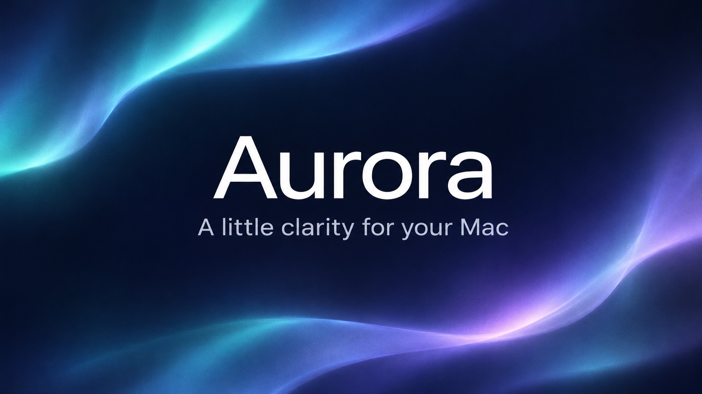
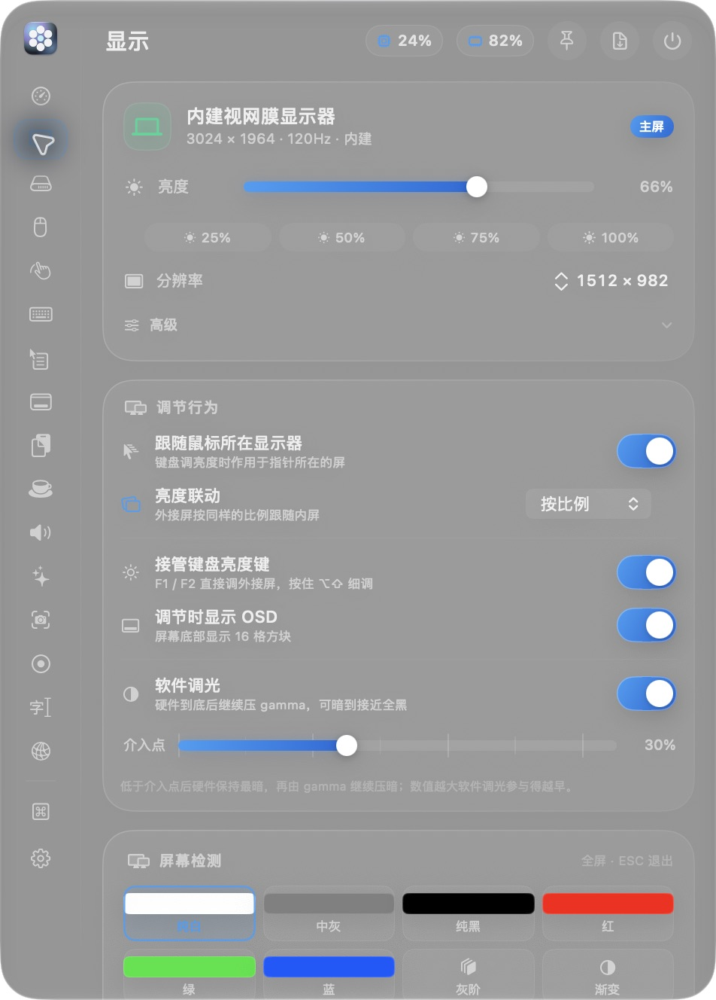
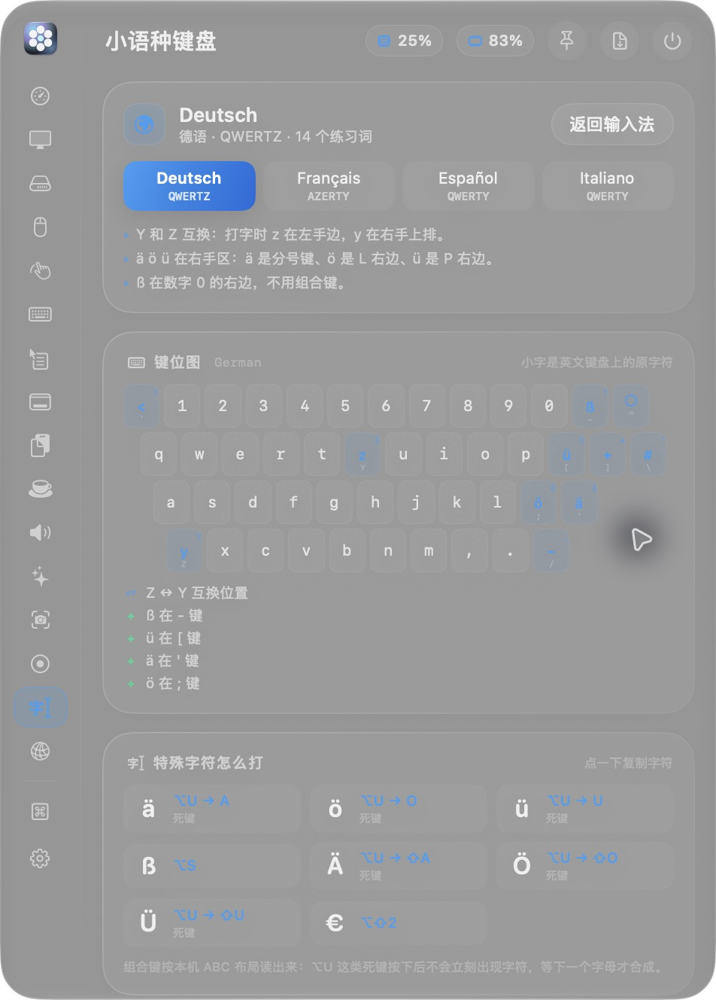
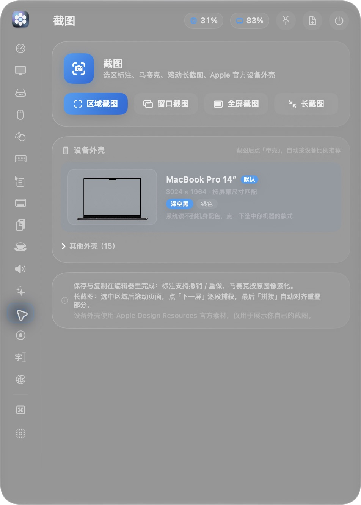

<div align="center">
  

# Aurora

**为 macOS 日常操作，留一个顺手的入口。**

在菜单栏里管理显示、输入设备、剪贴板、截图、网络与更多工具。

[下载 Aurora](https://github.com/CaryK753/Aurora/releases/latest) · [功能概览](#功能概览) · [安装与权限](#安装) · [参与贡献](#参与贡献)

[](https://github.com/CaryK753/Aurora/actions/workflows/ci.yml)
[](https://github.com/CaryK753/Aurora/releases/latest)
[](#系统要求)
[](LICENSE)

简体中文 · [English](README.en.md)

</div>

---

Aurora 是一款原生 macOS 菜单栏工具，使用 SwiftUI 与 AppKit 构建。点击菜单栏图标或按 **⌥⌘A** 即可打开面板；需要常驻时，也可以将其固定为普通窗口。模块可以按需启用和排序。

## 功能概览

| 类别 | 功能 |
| --- | --- |
| **系统与显示** | 查看处理器、内存、网络、电池和进程；调节内建或兼容 DDC/CI 的外接显示器；运行屏幕检测；管理声音设备和单应用音量。 |
| **输入设备** | 调整鼠标、触控板和键盘；配置部分罗技设备；查看按键状态；使用键盘清洁模式。 |
| **输入与效率** | 管理输入源与短语，练习德语、法语、西语和意大利语键位；保存、搜索、固定剪贴板历史；自定义 Finder 右键菜单。 |
| **创作与桌面** | 区域、窗口和全屏截图与标注；录制屏幕；使用视频、GIF 或程序生成的动态壁纸。 |
| **网络与安全** | 管理系统代理、订阅、策略组和规则；使用 Tailscale 组网；通过 Finder 文件锁加密文件或文件夹。 |
| **维护与其他** | 清理存储空间、管理应用与开发产物；阻止休眠；查看支持的工具在本地记录的 AI 用量。 |

输入法、录屏和网络模块目前标记为 **Beta（测试版）**。具体能力受系统版本、设备、权限及安装包配置影响；网络模块的支持范围和限制见[网络模块说明](docs/network-proxy.md)。

## 界面预览

以下截图来自 macOS 上实际运行的 Aurora，展示显示器设置与小语种键盘。

<table>
  <tr>
    <td><br><strong>显示</strong> — 亮度、分辨率与屏幕检测</td>
    <td><br><strong>小语种键盘</strong> — 键位图与特殊字符速查</td>
  </tr>
</table>

<details>
<summary>查看截图工具</summary>
<br>

</details>

## 系统要求

- macOS 26 或更新版本。
- 支持 Apple Silicon 和 Intel；官方安装包为通用二进制。

## 安装

1. 前往 [Releases（发布页）](https://github.com/CaryK753/Aurora/releases/latest)，下载最新的 `Aurora-<版本>.zip`。
2. 解压，将 `Aurora.app` 拖入「应用程序」。
3. 打开 Aurora，按照引导选择所需模块，并按需授予权限。

### 首次打开

发布包可能尚未经过 Apple 公证，macOS 可能阻止打开。请先确认安装包来自本仓库的发布页，并使用同名的 `.sha256` 文件核对下载内容：

```bash
cd ~/Downloads
shasum -a 256 -c Aurora-<版本>.zip.sha256
```

请把 `<版本>` 换成实际版本号，并在下载文件所在目录执行。校验和用于核对下载内容，不能单独证明文件来源可信。若 macOS 仍阻止打开，请检查「系统设置 → 隐私与安全性」中的提示；也可以选择[从源码构建](#从源码构建)。不要仅凭“已损坏”提示就假定文件一定安全。

### 从旧版本升级

1.5.0 及更早版本的更新器可能错误判断签名团队。从这些版本升级时，请先从发布页手动下载并安装新版本；之后可使用应用内更新。更新前请保留重要数据的备份。

## 权限与数据

Aurora 仅在使用相关功能时需要对应权限，可在应用内查看并管理。

| 权限 | 用途示例 |
| --- | --- |
| 辅助功能 | 鼠标按键映射、模拟按键和粘贴 |
| 屏幕与系统音频录制 | 截图、录屏及相关预览 |
| 输入监控 | 读取外接鼠标的原始按键 |
| 完全磁盘访问 | 可选；读取部分其他应用的本地配置或用量数据 |
| 通知、摄像头、麦克风 | 可选；用于通知或录屏相关功能 |

配置、剪贴板历史及网络订阅等数据保存在本机；网络代理功能会按需联网下载内核、订阅或规则数据。使用系统代理时，只有遵循系统代理设置的应用才会受影响；它不保证接管所有流量。更多细节见[网络模块说明](docs/network-proxy.md)。

> **文件锁提示**：文件锁依赖当前 Mac 登录钥匙串中的密钥。删除密钥、更换设备或覆盖加密文件可能导致无法恢复；使用前请保留独立备份。

## 常用快捷键

| 快捷键 | 操作 |
| --- | --- |
| `⌥⌘A` | 打开或收起主面板 |
| `⇧⌘V` | 打开迷你剪贴板 |
| `⌥⌘S` | 区域截图 |
| `⌥⌘R` | 开始或停止录屏 |
| `⌃⌥↑ / ⌃⌥↓` | 调整主显示器亮度 |
| `⌃⌥⌘K` | 退出键盘清洁模式 |

快捷键可在面板侧栏底部的「⌘」页面中配置；部分操作可能需要相应权限。

## 从源码构建

需要 Xcode 26 或更新版本及 Swift 6.2 或更新版本。

```bash
git clone https://github.com/CaryK753/Aurora.git
cd Aurora
AURORA_INSTALL=0 ./build.sh release
```

构建产物位于 `build/Aurora.app`。`AURORA_INSTALL=0` 避免自动安装；去掉该变量后，脚本默认会安装到 `/Applications`。如需通用二进制，可同时设置 `AURORA_UNIVERSAL=1`。签名身份与可选网络扩展的配置见 [build.sh](build.sh) 和[架构说明](docs/ARCHITECTURE.md)。

## 开发与测试

```bash
swift build --disable-sandbox
swift test --disable-sandbox
bash Tests/Localization/run.sh
bash Tests/SystemProxy/run.sh
```

部分集成测试需要网络、额外依赖或 macOS 系统权限。提交相关改动时，请运行对应的 `Tests/` 脚本，并说明验证环境。

- [架构说明](docs/ARCHITECTURE.md)
- [网络代理说明](docs/network-proxy.md)
- [性能测量](docs/PERFORMANCE.md)（历史版本数据）
- [更新日志](CHANGELOG.md)

## 参与贡献

欢迎通过 [Issues](https://github.com/CaryK753/Aurora/issues) 反馈问题或提出建议，也欢迎提交 Pull Request（拉取请求）。报告问题时请提供 macOS 与 Aurora 版本、复现步骤，以及不含敏感信息的日志或截图。涉及界面文案时，请同步检查中英文翻译。

## 许可证与致谢

Aurora 以 [MIT License（MIT 许可证）](LICENSE)发布。网络功能使用的第三方组件及许可说明见 [NetworkThirdPartyNotices.txt](Resources/NetworkThirdPartyNotices.txt)；mihomo 按需单独下载。

项目的功能与交互参考了 [LinearMouse](https://github.com/linearmouse/linearmouse)、[MonitorControl](https://github.com/MonitorControl/MonitorControl)、[Stats](https://github.com/exelban/stats)、[Mos](https://github.com/Caldis/Mos)、[RClick](https://github.com/wflixu/RClick)、[Maccy](https://github.com/p0deje/Maccy)、[KeepingYouAwake](https://github.com/newmarcel/KeepingYouAwake)、[switchaudio-osx](https://github.com/deweller/switchaudio-osx)、[CodexBar](https://github.com/steipete/CodexBar)、[usage](https://github.com/aqua5230/usage)、[QuickRecorder](https://github.com/lihaoyun6/QuickRecorder)、[Recordly](https://github.com/webadderallorg/Recordly)、[Snapzy](https://github.com/duongductrong/Snapzy) 与 [mihomo](https://github.com/MetaCubeX/mihomo)。
