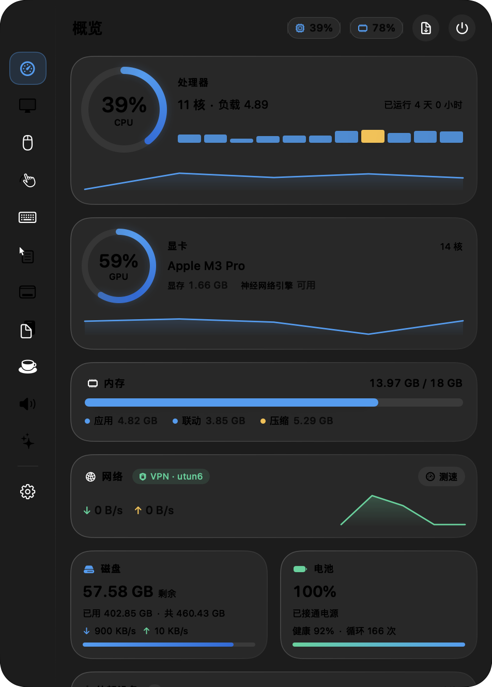
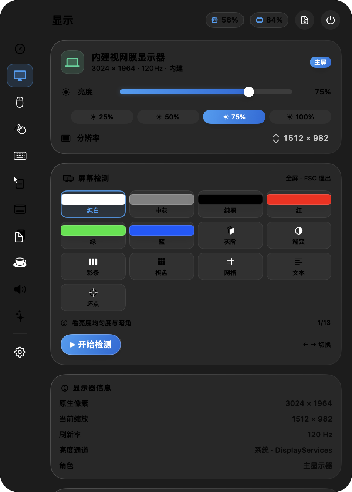
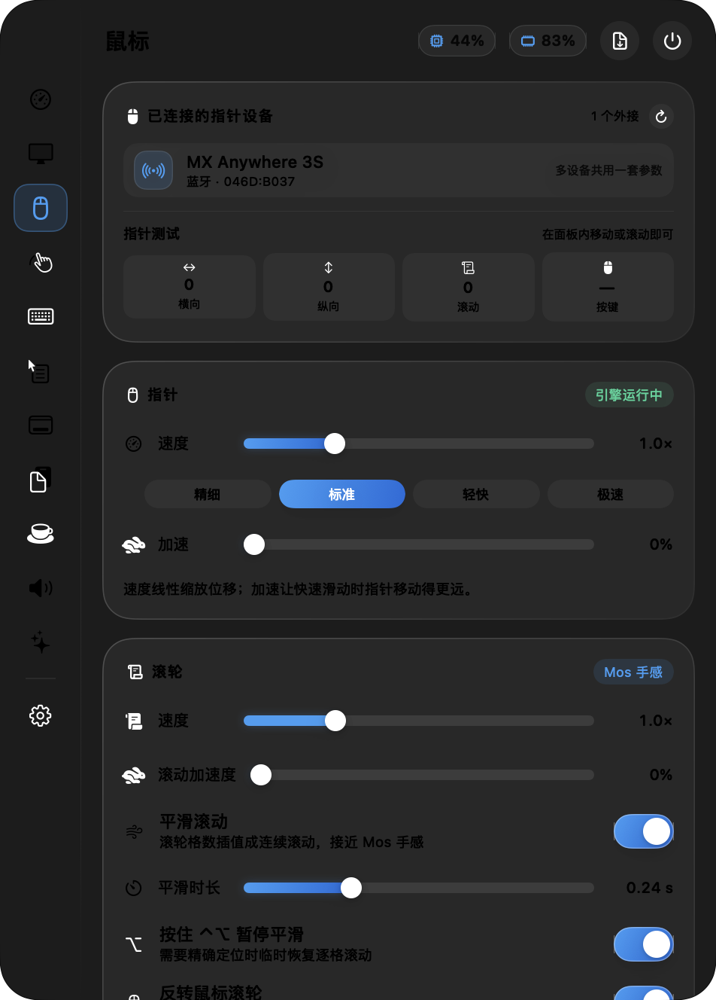
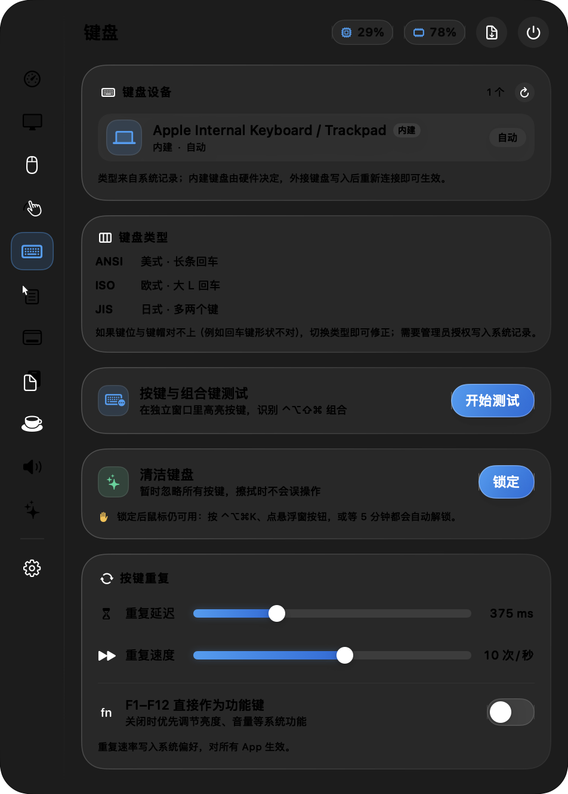
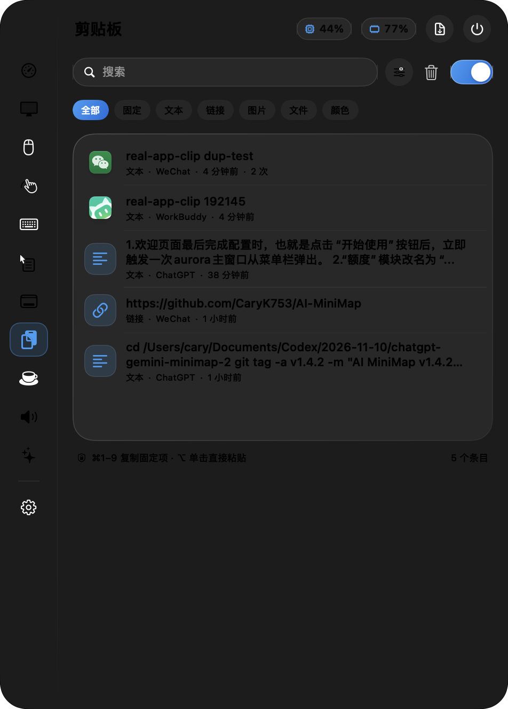
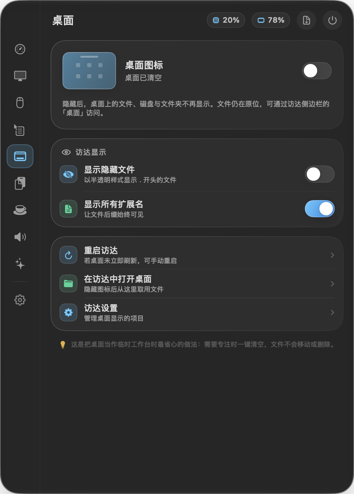
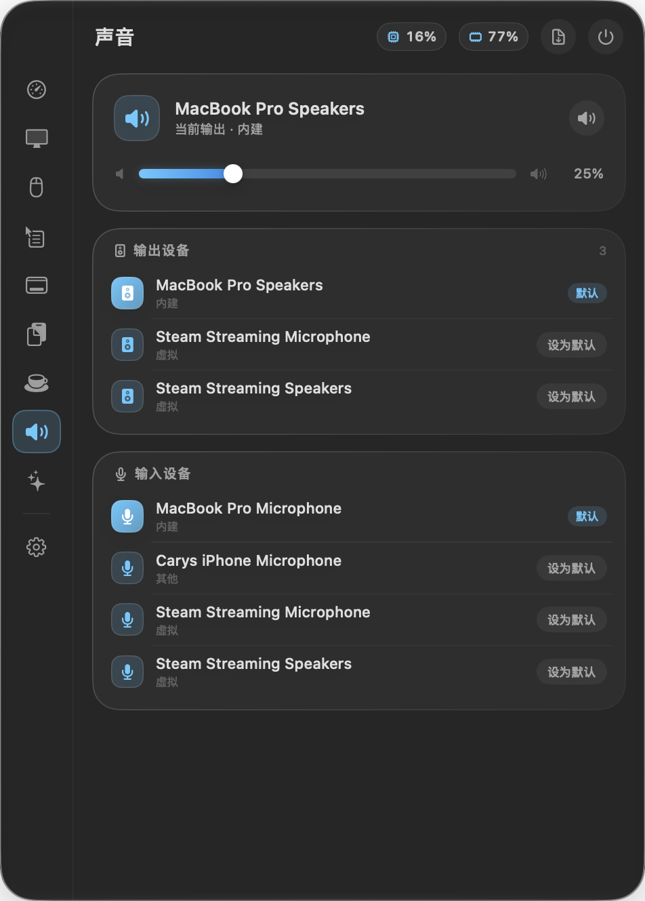
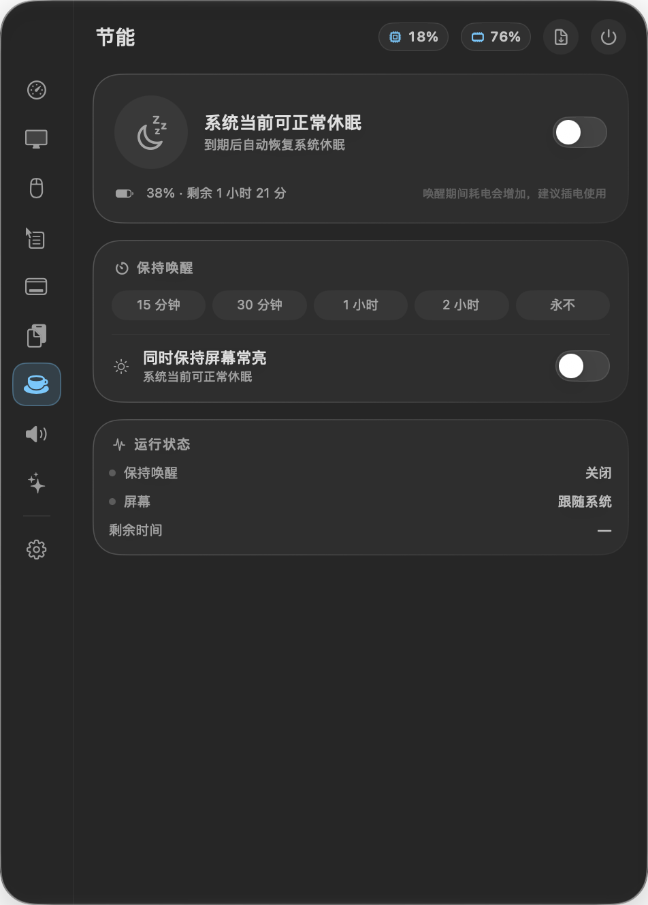
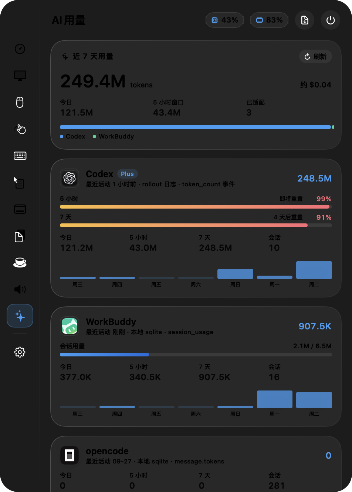
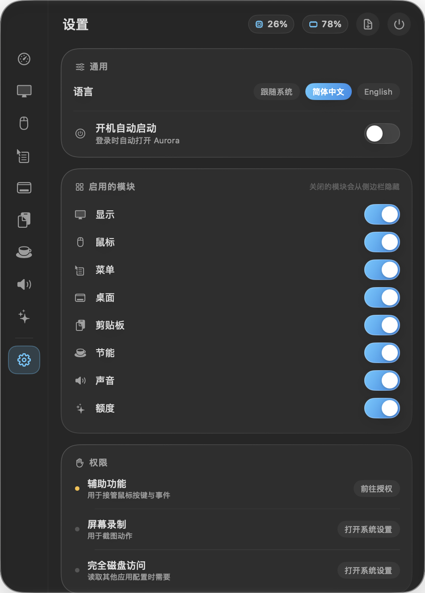

<div align="center">

# Aurora

**把 macOS 的日常设置，收进一个菜单栏面板**

显示器与屏幕检测 · 鼠标与键盘 · 右键菜单 · 剪贴板 · 胶囊式休眠 · 声音 · AI 用量 · 外部设备

[](https://github.com/CaryK753/Aurora/actions/workflows/ci.yml)
[](https://github.com/CaryK753/Aurora/releases/latest)
[](LICENSE)
[](#系统要求)

[简体中文](README.md) · [English](README.en.md)

</div>



## 简介

Aurora 是一个常驻菜单栏的原生 macOS 工具，用 SwiftUI 写成，界面是 macOS 26 的液态玻璃（Liquid Glass）。它把平时散落在「系统设置」、终端命令和一堆小工具里的操作合并到一个面板：点一下菜单栏图标，或者按 **⌥⌘A**。

默认是个点外面就收起的浮动面板；右上角的 **固定** 按钮可以让它变成正经的 macOS 窗口——左上角换成系统红绿灯，能最小化、能按 ⌘W 关掉，点别处也不会消失。取消固定立刻变回去。固定状态下窗口可以拖边缘调整大小（有上下限），绿钮进入 macOS 原生全屏，红绿灯与界面元素精确对齐；窗口拉宽后各模块卡片自动排成两列，充分利用空间。

动态壁纸说明：画面画在桌面层（Finder 壁纸之上、桌面图标之下），鼠标点击全部穿透；退出 Aurora 或关掉开关即还原系统壁纸，不动系统设置。锁屏 / 登录界面仍显示系统壁纸。

设计上有三条规矩：

- **能用系统接口就用系统接口**，不为了数字好看去伪造数据（例如按进程的 GPU 占用没有公开 API，就不凭空造一个）。
- **数据留在本地**。用量统计只读本地日志，不上传、不做联网校验。
- **接管是可逆的**。滚轮、音量、快捷键这类接管在关掉开关或退出应用后立刻归还系统。

## 功能

| 模块 | 能力 |
| --- | --- |
| **概览** | CPU（每核 + 曲线）、GPU、内存构成、网络（VPN 状态 + 测速）、磁盘容量与读写速率、电池健康度与循环次数；**外部设备**列出蓝牙 / USB 设备，Apple 设备使用专属图标并显示真实型号，AirPods 分别显示左右耳与充电盒电量，外接存储显示用量；可切换指标查看占用最高的进程 |
| **显示** | 内建屏亮度、外接屏 DDC/CI 亮度·音量·对比度、亮度预设与平滑过渡、分辨率切换、启动恢复亮度、**⌃⌥↑/↓ 全局调亮度**；**屏幕检测**覆盖纯色 / 灰阶 / 渐变 / 彩条 / 棋盘 / 网格 / 文本 / 坏点，全屏铺满所有显示器 |
| **鼠标** | 识别所有外接鼠标与指针实时测试；指针速度与加速度、滚轮速度与加速度、**平滑滚动**、鼠标与触控板**分别反转**、Shift 横向滚动、修饰键临时反转；**按键捕获映射**（像 Mos 那样点「捕获」后单独按下某个按键再指定动作，捕获期间窗口自动固定，不会误触快捷键收起） |
| **触控板** | 跟踪速度、轻点点按、双指辅助点按、自然滚动、放大旋转、页面轻扫、三指拖移，直接写入系统偏好 |
| **键盘** | 列出所有键盘（内建 / USB / 蓝牙、电量、VID:PID）；键盘类型 ANSI / ISO / JIS；**按键测试**窗口高亮物理按键并识别 ⌃⌥⇧⌘ 组合；**清洁键盘**临时吞掉所有按键；按键重复延迟与速度、F1–F12 功能键优先 |
| **菜单** | 内置 FinderSync 扩展实现的**自定义右键菜单**：复制路径、在终端打开、用指定 App 打开、运行命令、新建文件，可增删改、排序、单独开关，改完即时生效；同时管理系统的快速操作 / 服务 / Finder 扩展 |
| **桌面** | 隐藏或显示桌面图标、隐藏文件与扩展名、重启访达；**动态壁纸**：视频 / GIF 循环播放（可掐头去尾），支持固定一张、跟随浅色 / 深色外观（柔和过渡）、按一天内时间点、随机轮播四种自动规则；内置 4 个**程序生成动态场景**（极光 / 波浪 / 流光 / 暮色，不占磁盘、可自定义配色）；壁纸库直接拖入文件、按类型筛选、全屏预览、五种填充方式（填充 / 适应 / 拉伸 / 居中 / 平铺）、每个显示器独立设置；内置 Apple 壁纸库（含系统下载的航拍动态视频），外部壁纸库收录 Unsplash / Pixabay / Wallhaven / NASA / Coverr，可从直链下载 |
| **剪贴板** | 文本 / 富文本 / 链接 / 图片 / 文件 / 颜色六类记录；搜索、筛选、固定置顶、重复合并计数、快捷键复制与粘贴、纯文本粘贴、编辑与详情；忽略规则支持机密类型、指定 App、正则与单次忽略；输入密码时自动暂停记录 |
| **节能** | 15 分钟到 2 小时阻止休眠，可同时保持屏幕常亮；电量低于 20% 自动结束；登录后自动开启；**记住节能状态**——退出时还开着的话，下次打开 Aurora 自动恢复（可关） |
| **声音** | 输入 / 输出设备切换、音量与静音、**按应用单独调节音量**（0–150%） |
| **AI 用量** | 为每个本地 harness 单独适配：Codex（rollout 日志与真实配额窗口）、Claude Code、opencode、WorkBuddy 等；桌面客户端做安装检测并说明原因；汇总近 7 天、今日与 5 小时窗口 |
| **设置** | 语言（跟随系统 / 简体中文 / English）、外观、开机自启、模块启停、权限实时检测、自动更新、GitHub 入口与重置 |

## 截图

| 显示 | 鼠标 | 键盘 |
| --- | --- | --- |
|  |  |  |

| 剪贴板 | 菜单 | 声音 |
| --- | --- | --- |
|  |  |  |

| 节能 | AI 用量 | 设置 |
| --- | --- | --- |
|  |  |  |

## 系统要求

- **macOS 26 及以上**（液态玻璃面板依赖 `NSGlassEffectView`）
- Apple Silicon 与 Intel 均支持，官方安装包为通用二进制

## 安装

### 使用安装包（推荐）

1. 到 [Releases](https://github.com/CaryK753/Aurora/releases/latest) 下载 `Aurora-<版本>.zip`。
2. 解压后把 `Aurora.app` 拖进「应用程序」。
3. 按提示授予需要的权限（见下一节）。

#### 提示「已损坏，无法打开」怎么办

安装包没有经过 Apple 公证，在开启 Gatekeeper 的 macOS 上双击，可能直接弹窗：

> “Aurora”已损坏，无法打开。你应该将它移到废纸篓。

这**不是文件真的损坏**，而是下载后被打上了隔离属性（quarantine）。在终端执行一条命令即可解决：

```bash
sudo xattr -c /Applications/Aurora.app
```

然后重新打开应用（首次仍可能需要在 Finder 里**右键 →「打开」**确认一次）。应用不在「应用程序」目录时，把路径换成实际位置；如果只想移除隔离标记、保留其他扩展属性，也可以用：

```bash
sudo xattr -dr com.apple.quarantine /Applications/Aurora.app
```

> 安装包为 ad-hoc 签名、未公证，这是没有付费开发者账号的开源项目的常见做法，不代表应用有风险；你也可以直接从源码构建，构建出来的版本同样适用上面这条命令。

### 从源码构建

需要 Xcode 26 或更新版本（Swift 6.2+）。

```bash
git clone https://github.com/CaryK753/Aurora.git
cd Aurora
./build.sh                 # 编译、签名并安装到 /Applications/Aurora.app
```

常用参数：

```bash
AURORA_INSTALL=0 ./build.sh release       # 只打包，不安装到 /Applications
AURORA_UNIVERSAL=1 ./build.sh release     # 同时编译 arm64 与 x86_64
AURORA_VERSION=1.2.0 AURORA_BUILD=120 ./build.sh release
AURORA_SIGN_ID="Apple Development: ..." ./build.sh release
```

不传 `AURORA_SIGN_ID` 时会尝试用本机开发者证书签名，找不到就退回 ad-hoc。用固定证书签名可以避免「系统设置里已勾选但应用仍提示未授权」——TCC 按签名记录授权，ad-hoc 每次重建 cdhash 都会变。

## 首次启动与权限

首次打开会显示三步引导：功能简介、模块选择、按需授权。

| 权限 | 用途 | 是否必需 |
| --- | --- | --- |
| 辅助功能 | 指针接管、侧键映射、模拟粘贴与按键 | 鼠标模块需要 |
| 屏幕录制 | 截图动作、窗口预览 | 仅截图相关功能 |
| 输入监控 | 读取外接鼠标的原始按键 | 仅外接鼠标宏 |
| 完全磁盘访问 | 读取其他应用配置与本地用量数据库 | 可选 |

权限状态在「设置 › 权限」里每 3 秒复查一次，也可以手动点「重新检测」。如果系统显示已授权但应用仍提示未授权，先移除旧的 Aurora 条目再重新添加 `/Applications/Aurora.app`。

## 快捷键与手势

| 操作 | 说明 |
| --- | --- |
| **⌥⌘A** | 打开 / 收起主面板（菜单栏图标被挤掉时也能用） |
| **⌃⌥↑ / ⌃⌥↓** | 调整主显示器亮度，每次 6%，不用打开面板 |
| **⌘ + 拖动侧栏图标** | 调整模块顺序；拖出面板松手会询问是否停用该模块 |
| **⌘1 – ⌘9** | 剪贴板固定项一键复制（加 ⌥ 直接粘贴到上一个应用） |
| **⌃⌥⌘K** | 退出「清洁键盘」模式 |
| **ESC** | 关闭面板或退出屏幕检测；捕获鼠标按键时用于取消捕获 |
| **⌘W / ⌘M** | 固定成窗口后关闭 / 最小化（和普通 macOS 窗口一致） |

## 自动更新

应用内置更新器，读取本仓库的 GitHub Release：

- 默认**每小时**检查一次最新版本，发现新版本后自动下载。
- 下载完成后弹窗询问，确认后才替换 `Aurora.app` 并自动重启；选择「稍后」会保留提示，随时可以再更新。
- 也可以在「设置 › 关于」手动点「检查更新」，或关掉「自动更新」只保留手动检查。
- 更新只替换应用本体；设置、剪贴板历史与自定义菜单保存在 `~/Library/Application Support/Aurora`，不会丢失。
- 官方安装包由 CI 以 ad-hoc 方式签名。如果你之前用开发者证书签名并在本机构建，签名会发生变化，TCC 会把它当成另一个应用——**升级后需要在「系统设置 › 隐私与安全性」里重新勾选一次辅助功能等权限**（自己用固定证书构建的版本之间升级不会）。

## 项目结构

```
Sources/
├── Aurora/                      主应用（SwiftUI + AppKit）
│   ├── main.swift               入口与命令行工具
│   ├── AppDelegate.swift        菜单栏、快捷键、生命周期
│   ├── PanelController.swift    液态玻璃浮动面板
│   ├── AppState.swift           全局状态与服务装配
│   ├── Module.swift             模块注册表
│   ├── Core/                    各模块的服务实现
│   ├── UI/                      面板与各模块视图、组件库
│   └── SelfTest.swift           自检与诊断命令
├── AuroraFinder/                FinderSync 右键扩展（独立签名）
Modules/
└── LogitechPlugin/              罗技 HID++ 设备插件（含单元测试）
Resources/                       图标与 entitlements
Tests/                           面板、偏好、权限、功能回归脚本
Tools/                           图标生成工具
docs/                            截图与架构说明
```

构建与打包逻辑集中在 `build.sh`：编译 SwiftPM 目标、组装 `.app`、用 `swiftc -e _NSExtensionMain` 手工编译 Finder 扩展、分别签名。

## 开发与测试

```bash
swift build                      # 编译
swift test                       # 单元测试（LogitechPlugin）

Aurora --selftest                # 能力总览：显示器、采样、权限、GPU、音频、用量、菜单项
Aurora --scroll-test             # 滚轮变换：速度 / 反转 / Shift 横向 / 修饰键 / 残差
Aurora --clip-e2e                # 剪贴板端到端：去重、RTF 落盘、图片落盘
Aurora --keyboard-clean-test     # 清洁模式拦截与解锁
Aurora --device-test             # 枚举键盘与指针设备
Aurora --update-test             # 读取 GitHub Release 并比较版本，不下载
Aurora --update-test --download  # 连同下载与解包一起验证（不弹窗、不安装）
```

功能回归脚本在 `Tests/` 下：`bash Tests/Functional/run.sh`、`Tests/Panel/run.sh`、`Tests/Preferences/run.sh`、`Tests/Permissions/run.sh`。

架构与实现细节见 [docs/ARCHITECTURE.md](docs/ARCHITECTURE.md)。

## 持续集成

| 工作流 | 触发 | 内容 |
| --- | --- | --- |
| [`ci.yml`](.github/workflows/ci.yml) | push / PR | 编译、单元测试、打包 `.app`、签名校验，产物保留 7 天 |
| [`release.yml`](.github/workflows/release.yml) | 推送 `v*` 标签或手动触发 | 编译通用二进制、生成 zip 与 SHA-256 校验和、发布 GitHub Release |

发布新版本：

```bash
git tag v1.1.0
git push origin v1.1.0
```

## 参与贡献

欢迎 issue 与 pull request。

- 提交前请确认 `swift build` 与 `swift test` 通过。
- 新增模块时同步补中英文文案（`Localization.swift` / `ModuleTranslations.swift`）与英文 README 的功能表。
- 涉及系统接口改动的，尽量在 PR 描述里说明验证方式与已知限制。

## 许可证

本项目基于 [MIT License](LICENSE) 开源。

## 致谢

功能与交互参考了这些优秀项目，仅借鉴实现思路与配置语义，未复制源代码：

[LinearMouse](https://github.com/linearmouse/linearmouse) ·
[MonitorControl](https://github.com/MonitorControl/MonitorControl) ·
[Stats](https://github.com/exelban/stats) ·
[Mos](https://github.com/Caldis/Mos) ·
[RClick](https://github.com/wflixu/RClick) ·
[Maccy](https://github.com/p0deje/Maccy) ·
[KeepingYouAwake](https://github.com/newmarcel/KeepingYouAwake) ·
[switchaudio-osx](https://github.com/deweller/switchaudio-osx) ·
[CodexBar](https://github.com/steipete/CodexBar) ·
[usage](https://github.com/aqua5230/usage)
